# BayStream 1.0.0 · Manual de usuario

Edición de la versión **1.0.0 (9)**, publicada el 3 de noviembre de 2026 en los tres
clientes: la app de Windows, la app de Android y la Web. Escrita por Timonel (T-139,
4 de noviembre) a partir del manual de T-100 y recorrida pantalla por pantalla sobre
el mismo código de la 1.0.0. Las capturas están en `docs/manual-1.0.0/`, en tema claro
y a escala 2 para imprimirse en color; la oficina a 1920 × 1080 y el muelle a 360 dp.

Todos los datos de este manual son **sintéticos**: el buque «BUQUE MANUAL», el viaje
M100, la escala GTSTC y los contenedores MNLU no existen. La nube de las capturas es
un emulador local, nunca la de producción. Lo que no se pudo recorrer con esos datos
se marca **(no recorrido en esta edición)**: su descripción sale de los textos de la
propia app.

## Índice

1. Qué es BayStream y qué se necesita
2. Instalar y abrir: Windows, Android y la Web
3. Abrir un plano: el inicio, el archivo, ver primero y confirmar después, Recientes y
   «Volver al inicio»
4. El plano: la silueta y la bahía, cubierta y bodega, «Colorear por», el detalle y el zoom
5. Buscar un contenedor y la Lista
6. Estadísticas y Alertas de estiba
7. La nube y la operación
8. Exportar y el BAPLIE de salida
9. Claro y oscuro
10. Mensajes y qué hacer
11. Glosario

---

## 1. Qué es BayStream y qué se necesita

BayStream lee un archivo BAPLIE (EDIFACT, familia 2.x) y lo convierte en lo que el
planificador necesita ver: el plano de estiba por bahías, la lista de contenedores, las
estadísticas del viaje y las alertas de estiba. Sobre ese plano se registra la operación
de una escala: descargas, cargas, re‑estibas y tapas, desde la oficina y desde el muelle,
con la misma información en los dos sitios.

Está pensada para dos personas:

- **El planificador de la oficina**, en Windows o en la Web. Abre los archivos, confirma
  el perfil del buque y la escala, publica la operación, importa el listado de la
  agencia, revisa el avance y genera el BAPLIE de salida.
- **El personal del muelle**, en el teléfono. Se une a la operación publicada y registra
  lo que ocurre: qué contenedor bajó, cuál subió, qué se re‑estibó.

Lo que BayStream **no** hace: no inventa lo que el archivo no trae. El BAPLIE no transmite
la geometría del buque ni su límite de apilamiento; por eso la app los pide y, si no los
tienes, lo dice en pantalla en vez de suponer un número. Las alertas de estiba son
**apoyo a la decisión, no una verificación de cumplimiento**: la propia pantalla lo repite.

Qué se necesita:

| Cliente | Equipo | Cuenta |
|---|---|---|
| Windows | Windows 10 u 11 de 64 bits | Ninguna para trabajar en un solo equipo |
| Android | Un teléfono con acceso a la prueba interna de Google Play | Una cuenta de Google para instalar |
| Web | Chrome u otro navegador moderno, con conexión la primera vez | Ninguna |

Para publicar o unirse a una operación hace falta **una cuenta de BayStream** (correo y
contraseña) que crea el responsable; la app no tiene registro. Sin cuenta, todo lo que
haces se queda en ese dispositivo.

## 2. Instalar y abrir

### 2.1 Windows: el asistente

La app de Windows se entrega como un instalador con asistente, `BayStream_Setup_1.0.0.9.exe`,
junto con su huella `.sha256` y su manifiesto. Instala solo para tu cuenta de Windows y
no pide permisos de administrador.

1. Abre el instalador. La bienvenida resume qué hace BayStream y qué va a pasar. Pulsa
   «Siguiente».

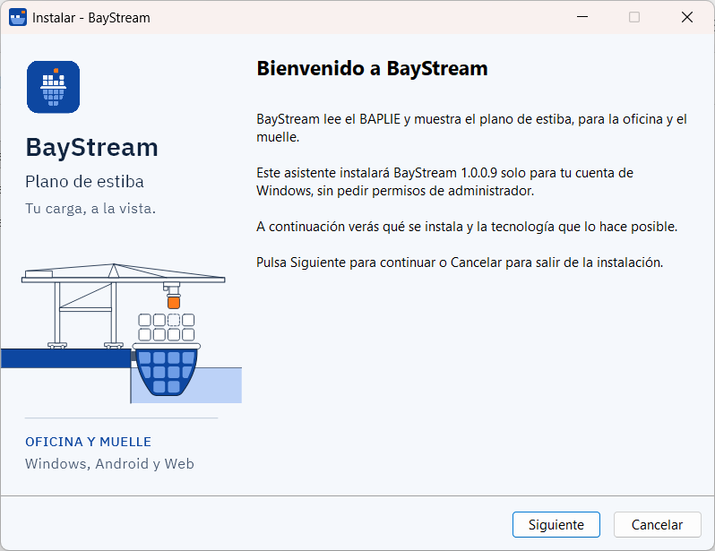

*Figura 1. La bienvenida del asistente de Windows.*

2. «Qué se instala» dice la versión, la carpeta de la aplicación y dónde viven tus datos:
   aparte, en `%LOCALAPPDATA%\BayStream`. El desinstalador quita la aplicación y sus
   accesos, nunca los datos.

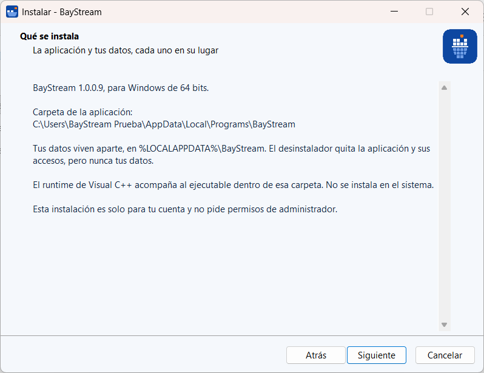

*Figura 2. Qué se instala y dónde quedan los datos.*

3. «Lo que hay detrás» enumera la tecnología (Flutter y Dart, Firebase, el lector
   BAPLIE/EDIFACT 2.2.1). Pulsa «Siguiente».
4. Elige la carpeta y, si quieres, un acceso en el escritorio. El acceso en Inicio se
   crea siempre. Si eliges la carpeta de los datos, el asistente la rechaza: «Elige otra
   carpeta: la instalación debe quedar separada de %LOCALAPPDATA%\BayStream, donde viven
   tus datos». Pulsa «Instalar».

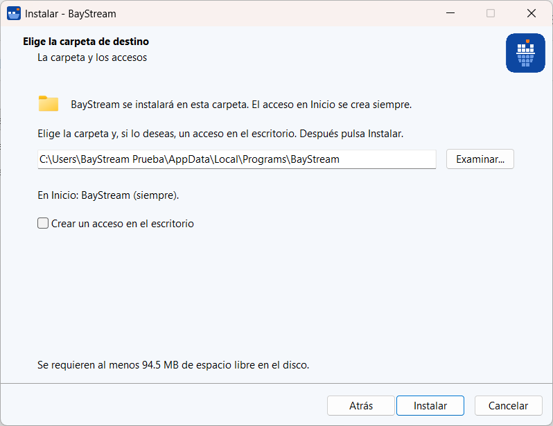

*Figura 3. La carpeta de destino y los accesos.*

5. Al terminar, «BayStream está listo». Deja marcado «Abrir BayStream» y pulsa
   «Finalizar»; también puedes abrirla desde Inicio.

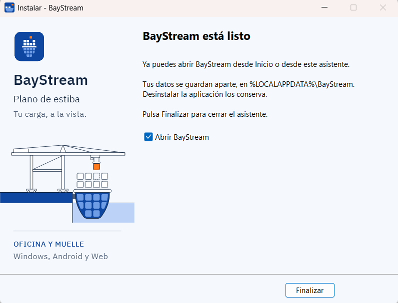

*Figura 4. El final del asistente, con «Abrir BayStream».*

Para desinstalar: Configuración → Aplicaciones → Aplicaciones instaladas → BayStream →
«Desinstalar». La confirmación dice que tus datos en `%LOCALAPPDATA%\BayStream` se
conservan. Cierra BayStream antes de desinstalar.

Si tu equipo ya tiene BayStream instalado como paquete MSIX (la instalación anterior,
desde el instalador de aplicaciones de Windows), el asistente se detiene y explica cómo
seguir; en ese caso, sigue las instrucciones del aviso o continúa con la MSIX.

### 2.2 Android: la prueba interna de Google Play

La app de Android se instala desde Google Play, con el enlace de la prueba interna que
entrega el responsable, y se actualiza sola.

1. Abre el enlace de la prueba interna con la cuenta de Google invitada y acepta ser
   probador.
2. En Google Play, pulsa «Instalar».
3. Abre «BayStream» desde el cajón de aplicaciones.

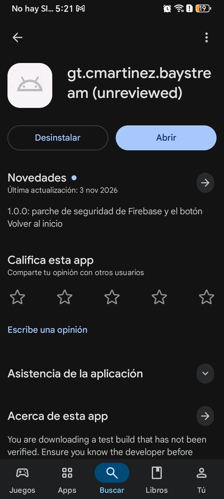

*Figura 5. BayStream en la prueba interna de Google Play. (Captura pendiente, la toma Carlos.)*

### 2.3 La Web

1. Abre `https://baystream-app.web.app` en Chrome. La primera vez necesita conexión.
2. La pantalla y los botones son los mismos que en Windows. El selector de archivos es
   el del navegador y los viajes recientes se guardan en el navegador.
3. Después de una visita completa, la Web vuelve a abrir sin red con los viajes
   recientes; lo que llegue de la nube espera a que haya conexión.

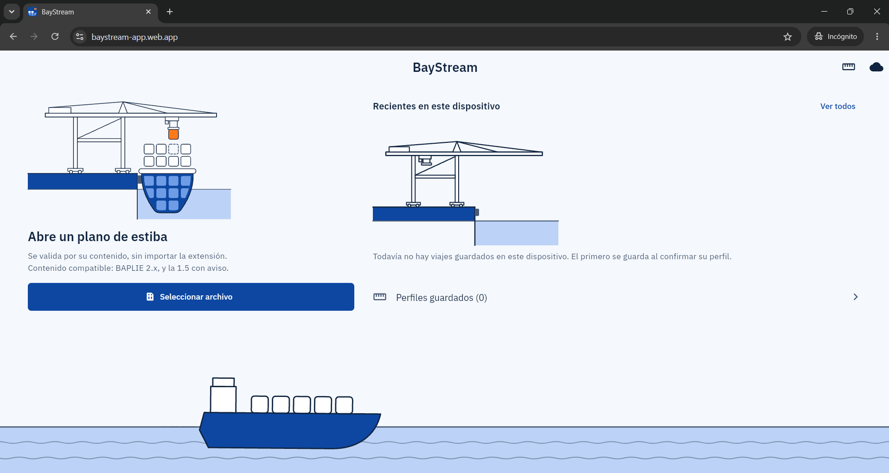

*Figura 6. La Web de BayStream en Chrome. (Captura pendiente, la toma Carlos.)*

## 3. Abrir un plano

### 3.1 El inicio

Al abrir, la app muestra el inicio: «Abre un plano de estiba», el botón «Seleccionar
archivo», los **Recientes en este dispositivo**, los **Perfiles guardados** y, con cuenta
autorizada, las **Operaciones abiertas en la nube**. Arriba a la derecha están
«Parámetros» (la regla) y «Nube y cuenta» (la nube). Debajo del botón se lee: «Se valida
por su contenido, sin importar la extensión. Contenido compatible: BAPLIE 2.x, y la 1.5
con aviso.»

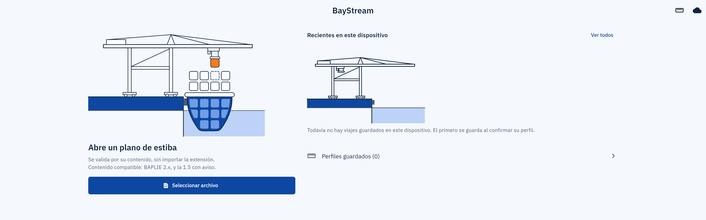

*Figura 7. El inicio en la oficina, todavía sin viajes.*

En el teléfono el inicio es el mismo, en una sola columna.

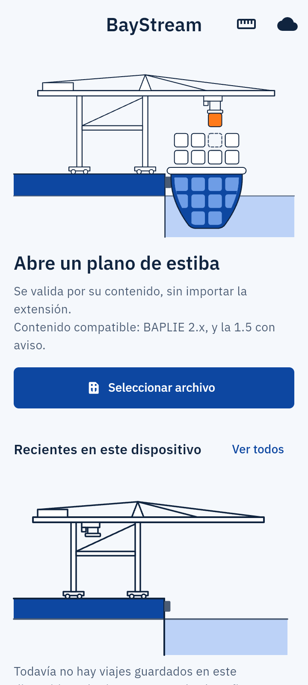

*Figura 8. El inicio en el teléfono.*

### 3.2 El archivo y el previo: ver primero, confirmar después

1. Pulsa «Seleccionar archivo» y elige el BAPLIE en el selector del sistema. La extensión
   no importa: un `.edi`, un `.txt` o un archivo sin extensión se leen igual.
2. **El plano abre enseguida, sin pedir nada**, en estado «Sin confirmar». Una banda azul
   lo dice: «Plano sin confirmar: perfil propuesto desde el archivo. Escala propuesta
   PAMIT.» Puedes mirar el plano, la lista y las estadísticas, buscar y cambiar
   «Colorear por». Lo que depende del perfil queda **«sin evaluar hasta confirmar el
   perfil»**: el peso por pila, las tomas de refrigerado y las alertas de peso.
3. Mientras no confirmes, no se guarda nada: el viaje no entra en Recientes y no hay
   operación. Si abres otro archivo o vuelves al inicio, la app pregunta «¿Descartar el
   plano sin confirmar?».

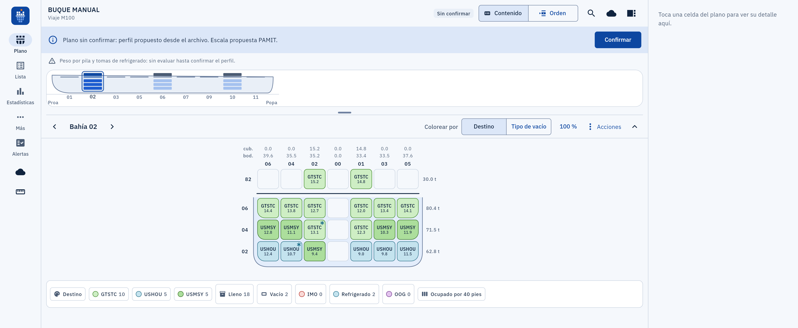

*Figura 9. El plano de llegada abierto en previo, con la banda «Plano sin confirmar» y «Confirmar».*

4. Pulsa **«Confirmar»**. Se abre «Parámetros del buque» con la propuesta del archivo.

### 3.3 Parámetros del buque: el perfil y la escala

El BAPLIE no transmite las dimensiones del buque: solo revela las posiciones que este viaje
trae ocupadas. Por eso la app propone **el mínimo observado** y te pide confirmarlo. Los
valores se pueden subir; bajarlos por debajo del mínimo dejaría carga fuera del plano.

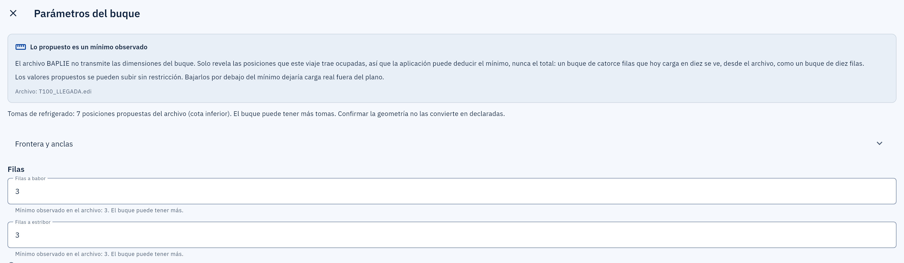

*Figura 10. «Parámetros del buque», de arriba abajo: el mínimo observado, las tomas, la frontera, las filas y los niveles.*

De arriba abajo:

1. **«Lo propuesto es un mínimo observado»** y el nombre del archivo.
2. **Tomas de refrigerado**: las posiciones propuestas del archivo son una cota inferior.
3. **Frontera y anclas** (plegado): la frontera cubierta / bodega (80) y el primer nivel de
   cada zona (02 y 82). Son los valores de la numeración ISO; normalmente no se tocan.
4. **Filas**: a babor y a estribor, con su mínimo observado, y si existe la fila 00 en
   cada zona.
5. **Niveles**: fichas de cubierta y de bodega; las que trae el archivo no se pueden
   quitar; «Agregar» suma el siguiente.
6. **Puerto de esta escala**: la decisión más importante. La pantalla explica qué puerto
   es cada uno: «El archivo se emitió al salir de PAMIT rumbo a GTSTC: para la salida, la
   escala es PAMIT; para la llegada, GTSTC.» Para operar la llegada **elige tu puerto**
   (GTSTC) y comprueba el reparto: «30 se descargan · 0 se cargan · 30 de paso».

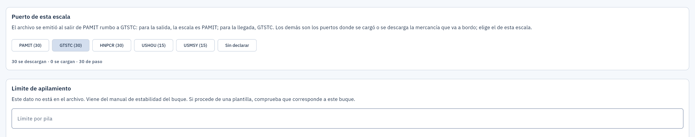

*Figura 11. La escala de un plano de llegada: GTSTC elegido y el reparto de la escala.*

7. **Límite de apilamiento**: no está en el archivo; viene del manual de estabilidad.
   Escribe «Límite por pila» en kg o marca «No lo tengo»: sin límite declarado no hay
   alertas de peso y la app no inventa un umbral. Hasta resolverlo, «Confirmar y ver el
   plano» queda apagado.
8. **Tomas de refrigerado**, **Tapas** («Editar tapas por bahía») y la **Rejilla
   resultante** («7 columnas × 4 niveles = 28 huecos por bahía»).
9. Pulsa **«Confirmar y ver el plano»**. El perfil se guarda, el viaje entra en Recientes,
   se crea la operación de la escala y el plano queda **«Publicado»**. «Cancelar la carga»
   vuelve al previo sin guardar nada. **«Publicado» en la cabecera quiere decir confirmado
   en este equipo**, no que esté en la nube: mientras el chip de la nube diga «Solo este
   dispositivo», la operación sigue solo aquí. Subirla a la nube es «Publicar operación»,
   en «Nube y cuenta» (7.3), y entonces la operación aparece como «Publicada».

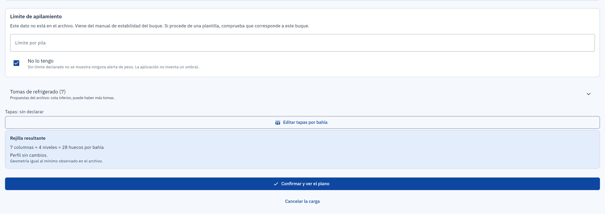

*Figura 12. «No lo tengo» marcado y «Confirmar y ver el plano» activo.*

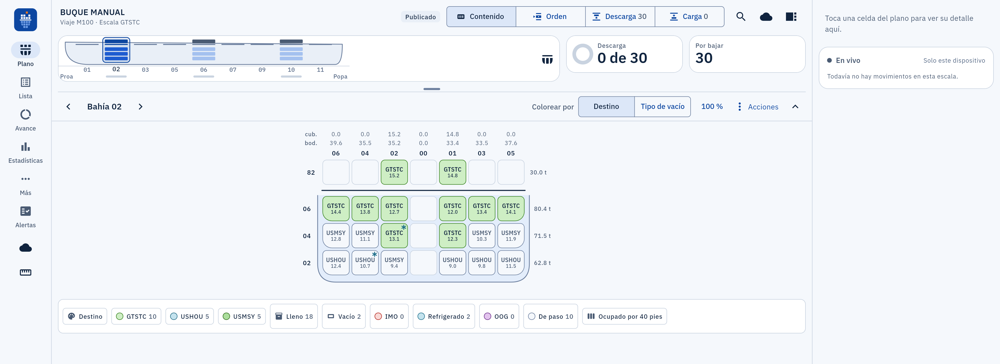

*Figura 13. El plano confirmado: «Publicado», la escala GTSTC en la cabecera y los modos Descarga y Carga ya disponibles.*

**La regla de publicación directa.** Un viaje de un buque con perfil guardado abre
publicado sin previo solo si el perfil cubre toda la carga **y** la escala propuesta
coincide con la última confirmada para ese buque. Si falta cualquiera de las dos, abre en
previo y te pide confirmar. Así un plano de llegada, que propone el puerto de salida, no
opera hasta que elijas tu puerto.

Si el buque es nuevo y ya hay otros perfiles guardados, antes de los parámetros aparece
«Perfil del buque nuevo» con «Proponer desde el archivo» o «Plantilla: <buque>»; si hay
perfiles con el mismo nombre, «Confirma la identidad del buque» **(no recorrido en esta
edición)**.

### 3.4 Recientes

Al volver al inicio, el viaje confirmado aparece en «Recientes en este dispositivo» con
su buque, viaje, cuenta de contenedores y bahías y la escala. Tócalo para reabrirlo sin
conexión ni archivo. «Ver todos» abre «Viajes recientes»: se conservan los últimos 5; al
guardar el sexto se elimina el más antiguo; los perfiles se conservan. La papelera elimina
un viaje de este dispositivo.

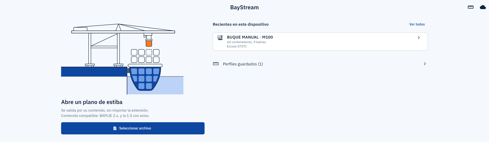

*Figura 14. El inicio con el viaje en Recientes y el perfil guardado.*

### 3.5 Volver al inicio

En la oficina, la marca de arriba del riel es el botón **«Volver al inicio»**; en el
teléfono, la entrada está en «Más». Con un plano confirmado, el subtítulo dice «Sigue en
Recientes; no se borra nada.»; con un previo, «Descarta el previo sin guardar nada» y
pregunta antes. Volver al inicio no detiene el envío a la nube de lo ya registrado.

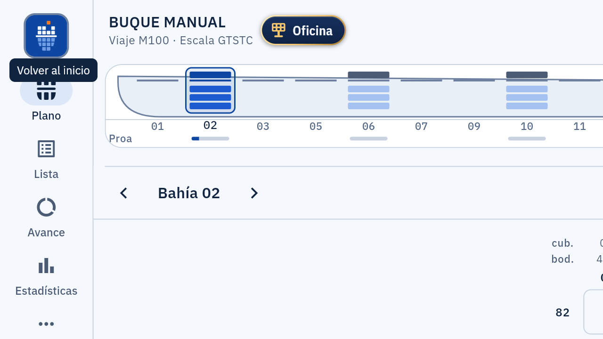

*Figura 15. La marca del riel es «Volver al inicio».*

### 3.6 Cómo se mueve uno: el riel, la barra y «Más»

En la oficina, el riel de la izquierda lleva **Plano, Lista, Avance, Estadísticas, Más y
Alertas**, y al pie, «Nube y cuenta» y «Parámetros». En el teléfono, la barra inferior
lleva Plano, Lista, Avance, Estad. y Más. «Avance» solo existe con una escala confirmada.

«Más» abre una hoja con lo demás: Alertas de estiba, Tapas en la operación, Orden de
descarga, Listado de la agencia (con un plan de carga), Comparar con otro BAPLIE…,
Exportar PDF, CSV y JSON, Cargar archivo BAPLIE, Viajes recientes, Perfiles guardados y
Volver al inicio. En el teléfono, además, Nube y cuenta y Parámetros.

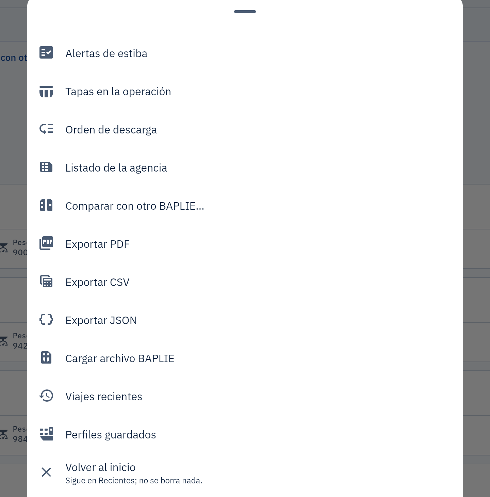

*Figura 16. La hoja «Más» en la oficina, con un plan de carga abierto.*

En Android, el botón Atrás del sistema cierra primero las hojas y los menús; en el plano
publicado, vuelve al inicio con **dos toques seguidos** («Toca Atrás otra vez para volver
al inicio»), para que un toque por error no te saque del plano **(no recorrido en esta
edición)**.

## 4. El plano

### 4.1 Qué se ve

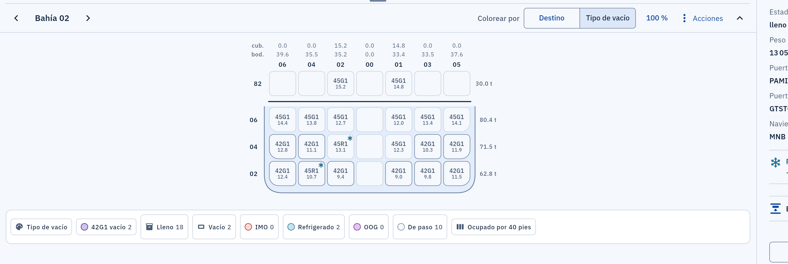

*Figura 17. La bahía 02 con «Colorear por» en «Tipo de vacío»: los vacíos en color y los llenos en papel.*

- **La cabecera**: el buque y el viaje, el estado («Publicado» o «Sin confirmar»), el
  **selector de modo** (Contenido, Orden, Descarga, Carga) y, a la derecha, Buscar, la nube
  y el botón del panel lateral.
- **El puente**: la **silueta del buque**, con la proa a la izquierda y una pila por bahía
  (cubierta sobre la línea de la tapa, bodega debajo); las bahías con trabajo en esta
  escala van más claras y bajo cada número hay una barra de avance. Toca una bahía para
  abrirla. A la derecha, las **tarjetas** de la operación («Descarga 0 de 30», «Por bajar
  30»). El borde de abajo pliega el puente, lo compacta o lo despliega.
- **La franja de la bahía**: ‹ y ›, el título «Bahía 02» (abre la lista de bahías),
  «Colorear por», el zoom, «Acciones» y el botón del puente.
- **La rejilla**: las **filas** en horizontal, pares a un lado y 00 e impares al otro,
  como en el plano impreso; los **niveles** en vertical, con cubierta arriba (82…) y bodega
  abajo (06, 04, 02), separadas por la línea de la tapa y dentro del casco. Sobre cada
  fila, «cub.» y «bod.»: el peso en toneladas de esa pila; a la derecha, el peso del nivel.
- **Cada celda** dice el destino (o el tipo ISO, según «Colorear por») y el peso en
  toneladas. Un asterisco es un refrigerado; un rombo rojo, una mercancía peligrosa.
- **La leyenda** de abajo, con las cuentas: los destinos, Lleno, Vacío, IMO, Refrigerado,
  OOG, De paso y «Ocupado por 40 pies».
- **La franja de cifras**, al pie: «Bahía 02: 20 contenedores, 244.7 t, tapas sin
  declarar» y lo que la operación dice de la bahía.
- **El panel lateral**, a la derecha desde 1200 dp: el detalle de la celda y «En vivo».

**Colorear por** cambia el color de las celdas: «Destino» (el puerto de descarga de cada
contenedor) o «Tipo de vacío» (el tipo ISO de los vacíos; los llenos en papel). En modo
Descarga, además, «Estado».

### 4.2 Cubierta y bodega, y las sombras de los 40 pies

Un contenedor de 40 o 45 pies se estiba en una bahía par y ocupa las dos impares vecinas.
En la bahía par aparece el contenedor; en las impares, la celda sale como «Ocupado por 40
pies» y la bahía figura en la silueta aunque no tenga carga propia. Lo pendiente de carga
se cuenta por el grupo de la par: la ficha lo dice como «grupo 22 (21, 22 y 23)».

### 4.3 El detalle de un contenedor

Toca una celda. En la oficina el detalle aparece en el panel lateral; en el teléfono, en
una hoja. Trae el número, la naviera, «45R1 · 40 pies · lleno», la celda, el tipo ISO, el
estado, el peso bruto (o el VGM), el puerto de carga y el de descarga, la naviera, el
refrigerado con su temperatura o la mercancía peligrosa con su clase, y lo que la escala
dice de él: «En GTSTC: por descargar».

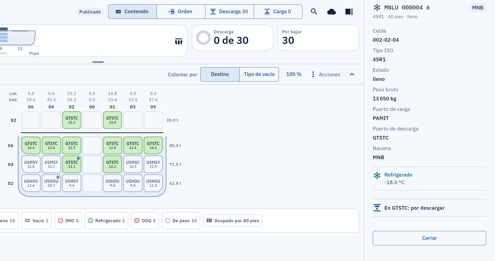

*Figura 18. El detalle de un refrigerado en el panel lateral.*

### 4.4 El zoom

Toca «100 %» en la franja de la bahía: aparecen «Alejar plano», «Restablecer» y «Acercar
plano», del 75 % al 300 %. En la oficina también funciona **Ctrl + rueda** del mouse
sobre la rejilla y el pellizco en el touchpad; en el teléfono, el pellizco de dos dedos.
El punto bajo el puntero se queda quieto.

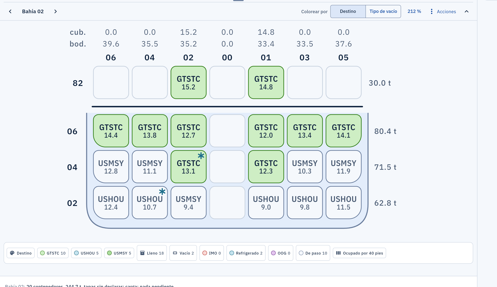

*Figura 19. La rejilla al 212 % con Ctrl + rueda.*

### 4.5 El plano en el teléfono

A 360 dp el selector de modo es un menú («Contenido ⌄»), «Acciones» va solo con su icono
(⋮) y la línea de resumen se abre y se recoge. La silueta y la rejilla se desplazan en
horizontal con el dedo. El distintivo del rol va junto al título.

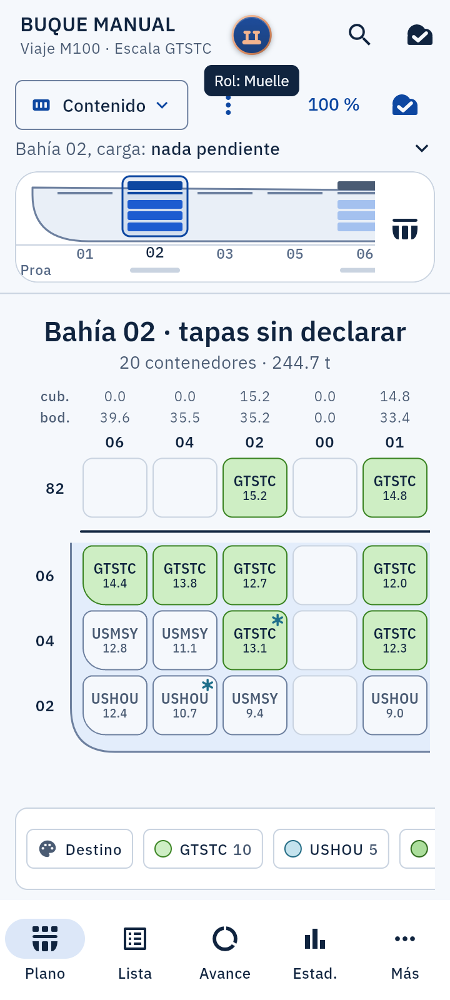

*Figura 20. El plano en el teléfono, con la sesión de muelle.*

## 5. Buscar un contenedor y la Lista

### 5.1 La búsqueda

1. Toca «Buscar contenedor» (la lupa). Sin escribir nada, la pantalla dice cuántos
   contenedores hay y ofrece las navieras y los puertos de descarga del viaje.
2. Escribe **el número completo o solo parte**, por ejemplo los últimos dígitos: «0004».
   La lista se filtra mientras escribes y resalta la parte que coincide. También vale un
   puerto o una naviera.
3. Toca un resultado: el plano abre la bahía del contenedor y lo resalta.

*Figura 21. La búsqueda por los últimos dígitos, con la coincidencia resaltada.*

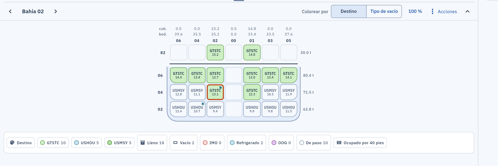

*Figura 22. El contenedor elegido, resaltado en su bahía.*

### 5.2 La Lista

La pestaña «Lista» trae la tarjeta del viaje (buque, viaje, contenedores, bahías, peso
total, la escala y su reparto), los botones «Generar BAPLIE de salida», «Alertas de
estiba», «Comparar con otro BAPLIE…» y «Orden de descarga», el filtro por naviera y una
tarjeta por contenedor: número, naviera, lleno o vacío, tipo, posición, peso y destino.
Toca una tarjeta para ver el detalle. Si el archivo trae avisos de lectura (pesos
revisados, posiciones mal formadas, dígitos de control inválidos, segmentos que faltan),
salen aquí con su cuenta y qué hacer.

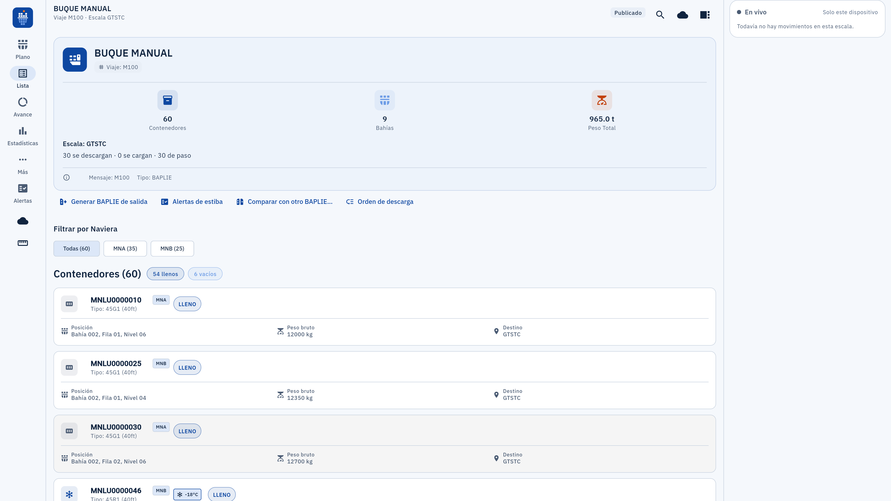

*Figura 23. La Lista del plano de llegada.*

## 6. Estadísticas y Alertas de estiba

### 6.1 Estadísticas: el buque en corte

La pestaña «Estadísticas» encabeza con la cifra del viaje, «60 contenedores a bordo», y
debajo el peso total, las bahías con carga, los llenos y los vacíos. **«Carga por bahía,
de proa a popa»** es el buque en corte: cada bahía con dos pilas, cubierta hacia arriba y
bodega hacia abajo, cuya altura dice los contenedores o el peso según «Contenedores /
Peso». Toca una bahía para abrirla en el plano. Debajo, cinco paneles: **Por puerto de
descarga**, **Llenos y vacíos** (el anillo), **Carga especial** (peligrosa IMDG,
refrigerado, fuera de medida), **Por naviera** y **Por tamaño**. «Ver como tabla» cambia
los gráficos por las mismas cifras en tablas.

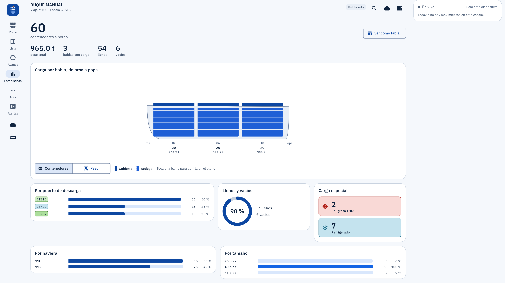

*Figura 24. Estadísticas en la oficina.*

### 6.2 Alertas de estiba

«Alertas» (en el riel, o en «Más» en el teléfono) abre el panel. Lo primero que dice es lo
que hay que recordar: «Apoyo a la decisión. Revisar con el planificador; este panel no
verifica cumplimiento.» La fuente es el Código IMDG, Enmienda 42-24; **no se evalúa la
columna 16b** de la Lista de mercancías peligrosas, que tiene prioridad.

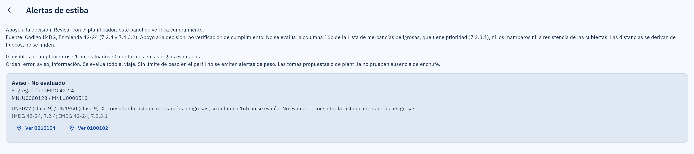

*Figura 25. Alertas de estiba: un par de peligrosas «no evaluado», con «Ver» a cada celda.*

| Regla | Cuándo se evalúa | Si no se puede |
|---|---|---|
| Peso por pila | Con un límite de apilamiento en el perfil | «Sin límite de peso en el perfil no se emiten alertas de peso» |
| Toma de refrigerado | Con tomas declaradas | «Las tomas propuestas o de plantilla no prueban ausencia de enchufe» |
| 20 pies sobre 40 pies | Siempre | — |
| Segregación · IMDG 42-24 | Entre pares de peligrosas, por clase | «consultar la Lista de mercancías peligrosas; su columna 16b no se evalúa» |

Cada alerta trae su nivel («Error · Posible incumplimiento», «Aviso · No evaluado»,
«Información · Conforme en las reglas evaluadas»), la regla, los contenedores, la
referencia y «Ver <celda>», que abre el plano ahí. Con un previo sin confirmar, las de
peso dicen «sin evaluar hasta confirmar el perfil».

## 7. La nube y la operación

La operación es lo que se registra sobre una escala: descargas, cargas, re‑estibas y
tapas. Se guarda en el dispositivo y, con cuenta, se publica en la nube para que la
oficina y el muelle trabajen sobre la misma. Todo queda en una bitácora que solo anexa:
deshacer un movimiento no lo borra, lo anula.

### 7.1 La sesión

Abre «Nube y cuenta» (la nube del riel o de la barra superior). Sin cuenta: «Sin cuenta,
lo que registres se queda en este dispositivo. Las cuentas las crea el responsable: la app
no tiene registro.» Escribe «Correo» y «Contraseña» y pulsa «Iniciar sesión». «Olvidé mi
contraseña» envía un enlace al correo. Debajo, «Operación de la escala abierta» muestra la
del plano abierto: «Solo en este dispositivo», «Publicada» o «Publicada y cerrada», con
sus fuentes (llegada, carga, listado).

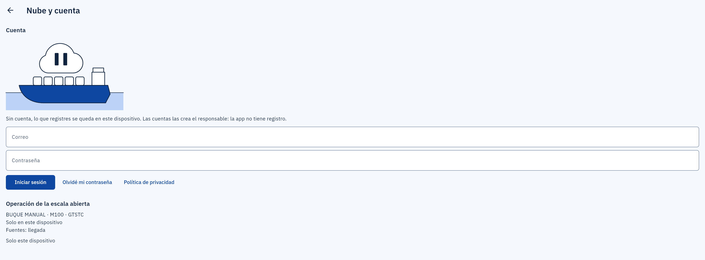

*Figura 26. «Nube y cuenta» sin sesión, con la operación local.*

### 7.2 Los roles y su distintivo

Con sesión, la pantalla muestra el nombre y el rol: **Oficina** o **Muelle**, y «Cuenta
autorizada» (o «Cuenta sin autorizar: lo que registres espera a que el responsable la
active.»). Desde entonces, junto al título del viaje aparece el **distintivo del rol**,
dorado para la oficina y naranja para el muelle, y el chip de la nube dice «Al día».

- **Oficina**: publica y cierra la operación, agrega el plan que falta, importa el
  listado, decide las solicitudes de cambio y genera el BAPLIE de salida.
- **Muelle**: registra descargas, cargas, re‑estibas y tapas, y pide cambios.

### 7.3 Publicar desde la oficina

Con el plano de llegada confirmado y la sesión de oficina, pulsa «Publicar operación».
La pantalla dice «Operación publicada.», el estado pasa a «Publicada» con «Al día», y la
operación aparece en «Operaciones abiertas en la nube» con «Abrir plano de llegada».

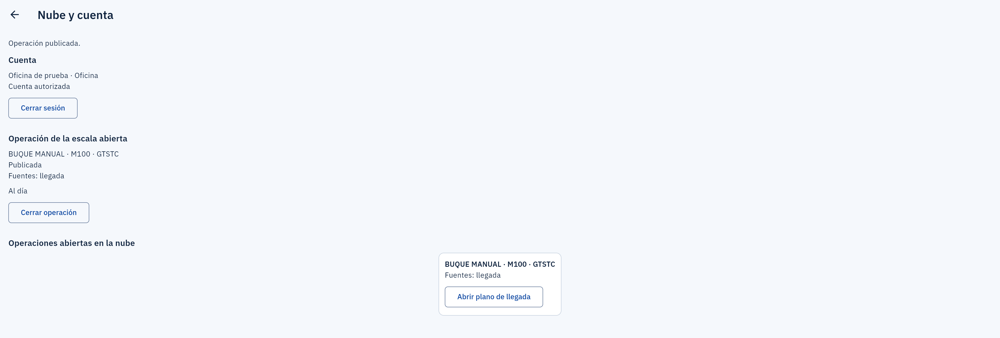

*Figura 27. La operación publicada por la oficina.*

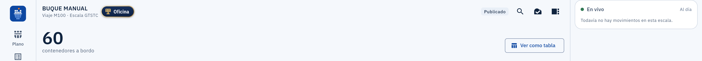

*Figura 28. La cabecera de la oficina con el distintivo «Oficina» y la nube «Al día».*

### 7.4 Unirse desde el muelle

En el teléfono, abre «Nube y cuenta», inicia sesión con la cuenta de muelle y, en
«Operaciones abiertas en la nube», pulsa **«Unirse»**. La app confirma «Te uniste a la
operación. Abre su plano para trabajar.» y ofrece «Abrir plano de llegada»: el plano se
descarga de la nube y se abre ya confirmado.

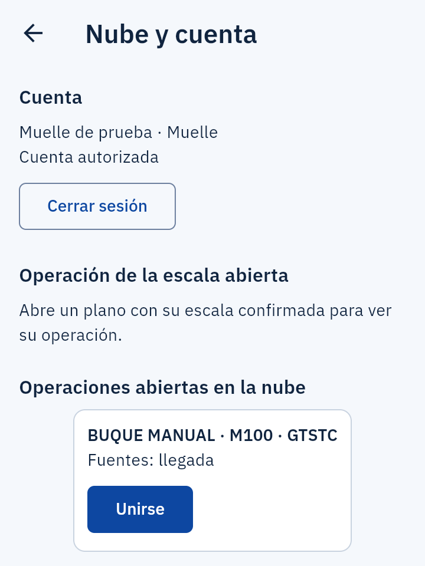

*Figura 29. La operación abierta en la nube, con «Unirse», desde el teléfono.*

### 7.5 Descargar

1. En el plano, abre el selector de modo y elige **«Descarga»** («30 por bajar en GTSTC»).
   Las celdas que bajan en esta escala van en azul; las que siguen viaje, en papel («de
   paso»). La leyenda pasa a «Estado»: Por bajar, Bajado.

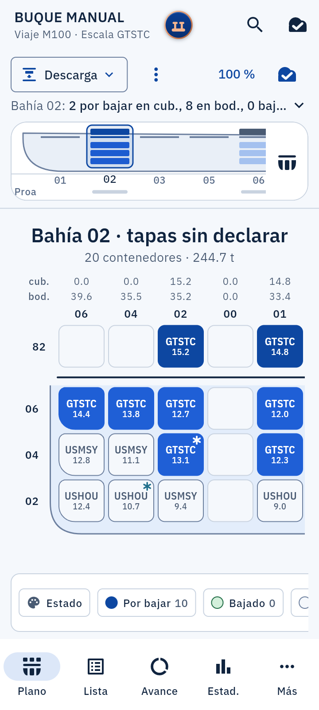

*Figura 30. El modo Descarga en el teléfono.*

2. Toca una celda por bajar. Queda marcada con una palomita y abajo aparece «Descargado ·
   MNLU0000107 · 002-02-82» con **«Deshacer»** durante unos segundos. La barra de la
   bahía en la silueta avanza.

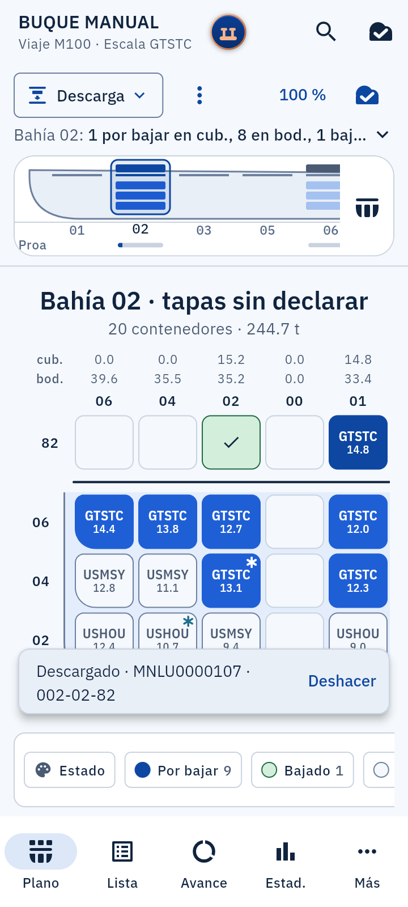

*Figura 31. Una descarga registrada, con «Deshacer».*

3. Si tocas una celda de paso, la app pregunta si es una **re‑estiba**: «MNLU0000405 no
   se descarga en GTSTC: va a USMSY. Si sale del buque para volver a estibarlo, se
   registra como re‑estiba y no cuenta entre los que bajan aquí.» Escribe el motivo si
   quieres y pulsa «Registrar re‑estiba». La celda queda en naranja, «Re‑est.».
4. «Acciones» (⋮) ofrece «Pendientes por bahía», «Avance de la operación», «Solicitudes de
   cambio» y, en Carga, «Asignar vacío».

### 7.6 El avance

«Avance» (en el riel o en la barra) muestra la tabla por bahía: «Descarga», «Carga ·
llenos», «Carga · vacíos», «Cancelados», «Conflictos», «Tapas PROVISIONAL» y «Último
movimiento» con quién lo hizo, más la fila TOTAL, los conflictos y el peso de las pilas.
En la oficina, el panel **«En vivo»** lista cada movimiento del muelle en cuanto llega:
«Bajado · Muelle», «Re‑estiba · Muelle», con el contenedor y la celda.

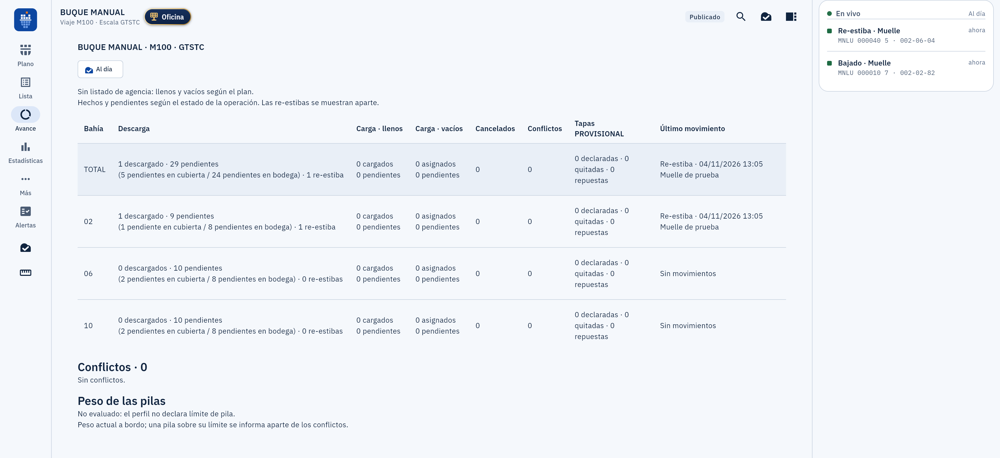

*Figura 32. El avance en la oficina con la descarga y la re‑estiba del muelle, y «En vivo».*

### 7.7 Agregar el plan de carga a la operación publicada

Cuando llega el plan de carga, la oficina lo abre como cualquier BAPLIE («Más» → «Cargar
archivo BAPLIE»). El previo lo reconoce: «La escala GTSTC ya tiene una operación
publicada (viaje M100) sin plan de carga: confirma para agregarlo.»

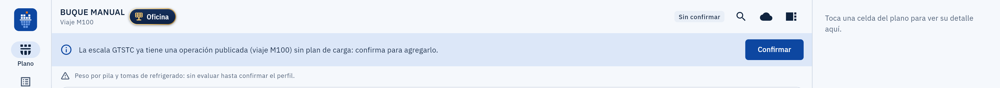

*Figura 33. El plan de carga abierto en previo sobre la operación publicada.*

Pulsa «Confirmar», revisa los parámetros (la escala ya viene en GTSTC) y «Confirmar y ver
el plano». Un diálogo resume lo que va a pasar: «publicada el 4-nov, 12:59, abierta, sin
plan de carga», «Se cargan 30 contenedores y 0 celdas reservadas; se descargan 0», «El
muelle lo recibe solo. Los movimientos registrados no se pierden ni cambian.» Pulsa
**«Agregar a la operación M100»**. Desde entonces el plano muestra «Carga 30» y el muelle
recibe el plan sin hacer nada.

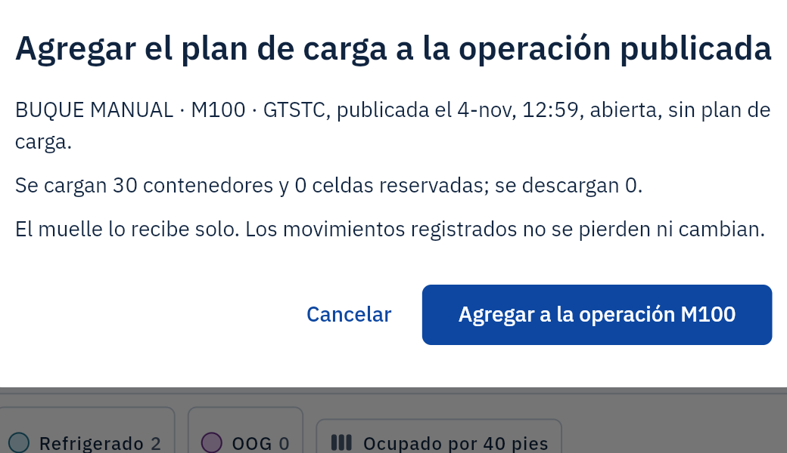

*Figura 34. El diálogo que agrega el plan de carga a la operación publicada.*

Lo mismo al revés: si se publicó primero el plan de carga, el plano de llegada se agrega
igual. Un plan que ya está en la operación no se reemplaza: el previo lo dice y «Descartar»
lo cierra **(no recorrido en esta edición)**.

### 7.8 El listado de la agencia

Con el plan de carga abierto, «Más» → **«Listado de la agencia»** → «Elegir listado
(.xlsx)». La app lo lee y resume: «30 filas en 2 agencias · 20 llenos · 10 vacíos», las
agencias con su cuenta y las filas que no entendió («Fila 39: No es un contenedor ni un
separador de agencia: «TOTAL 30 CONTENEDORES»…»; una fila de totales se puede ignorar).
En **«Equivalencias con el plan»** propone cómo se escribe cada tipo en el plan («Tipo 40ST
→ 42G1 · Propuesta: 11 contenedores están en el listado y en el plan.»); el lápiz corrige
cualquiera. **«Cruce con el plan de GTSTC»** dice cuántos llenos cruzan y cuántos vacíos
caben en las reservas.

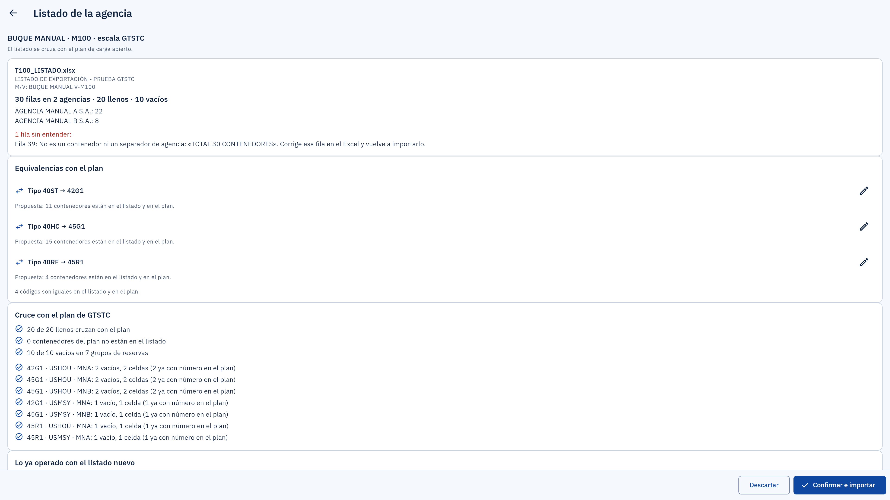

*Figura 35. El listado leído: el resumen, las equivalencias propuestas y el cruce con el plan.*

Pulsa **«Confirmar e importar»**: «Listado guardado en la operación publicada de GTSTC: 30
filas, revisión 1. El muelle lo recibe solo.» «Importar otro listado (.xlsx)» guarda una
revisión nueva; lo ya operado no se pierde. Desde entonces el plano muestra el **número de
orden** de cada carga («OR 7 · Sube») y se opera por OR.

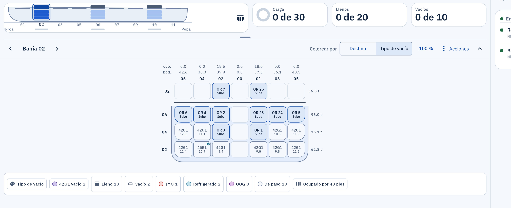

*Figura 36. El plano en «Orden»: cada carga pendiente con su OR, y las tarjetas de carga.*

### 7.9 Cargar por OR desde el muelle

1. Elige el modo **«Carga»**. Las celdas pendientes dicen «OR 7 · Sube». En la línea de la
   bahía está **«OR / últimos dígitos»**.

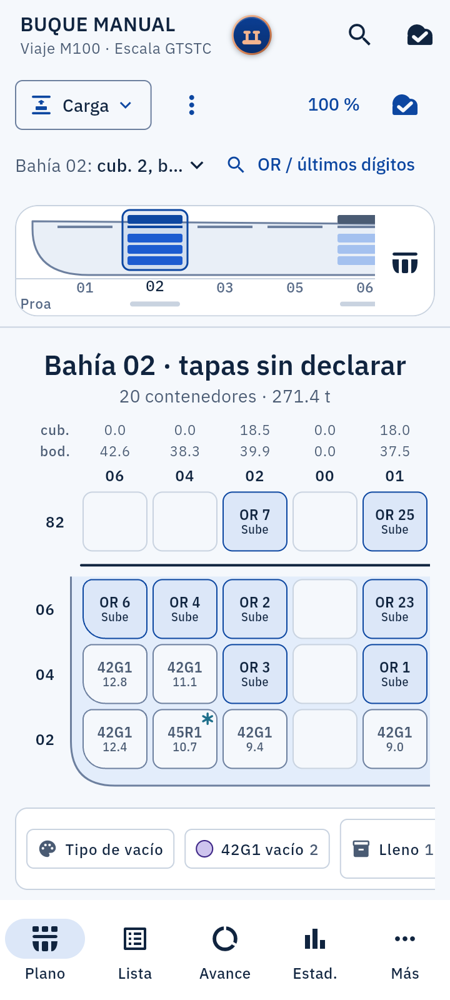

*Figura 37. El modo Carga en el teléfono, con los OR del listado y el campo «OR / últimos dígitos».*

2. Toca la celda, o pulsa «OR / últimos dígitos» y escribe el OR o los últimos dígitos del
   contenedor: «Confirmar carga por OR o contenedor» filtra mientras escribes. En Android,
   el micrófono dicta la búsqueda en español **(no recorrido en esta edición)**.
3. Se abre **«Confirmar carga»**: «OR 7 · MNLU0000703», tipo, puerto y línea, «Posición
   planificada: 002-02-82», «Celda donde quedó (opcional)» (otra celda pide motivo), la
   pila con su peso, «Revisado: tipo, celda y grupo coinciden con el plan.», la hora
   (opcional), la fecha y el marchamo (opcional). «Pedir cambio» envía una solicitud a la
   oficina en vez de cargar. Pulsa **«Confirmar carga»**.

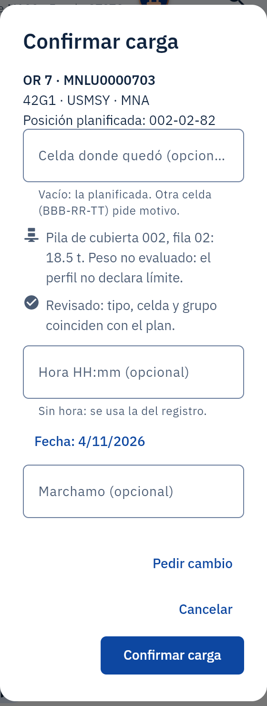

*Figura 38. «Confirmar carga» para el OR 7.*

4. La celda queda «OR 7 · Cargado» y abajo dice «Carga registrada · OR 7» con «Deshacer».
   La oficina lo ve enseguida en «En vivo» y en el avance.
5. Si la celda planificada **todavía la ocupa un contenedor que baja aquí**, el formulario
   lo advierte: «La celda la ocupa MNLU0000093, que baja en GTSTC y no se ha marcado.
   «Marcar su descarga y cargar» registra las dos cosas.» Ese botón registra la descarga y
   la carga a la vez: «Descarga y carga registradas · OR 25».

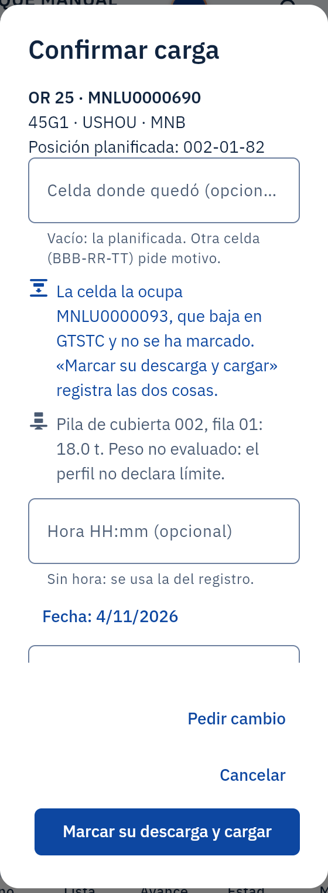

*Figura 39. La celda planificada sigue ocupada: «Marcar su descarga y cargar».*

6. **Un vacío**: «Acciones» → «Asignar vacío» abre «Vacíos del listado» (los OR vacíos con
   su tara). Elige uno: el formulario es el mismo, con la tara real.

Deshacer: el aviso de abajo ofrece «Deshacer» unos segundos. Después, se corrige desde el
detalle de la celda; el movimiento no se borra, queda anulado con su motivo.

**Mover y solicitudes de cambio.** La oficina puede arrastrar un contenedor o una reserva
a otra celda de la misma bahía en el plan de carga, con un motivo obligatorio; el muelle
pide cambios con «Pedir cambio» y la oficina los aprueba o rechaza en «Solicitudes de
cambio» **(no recorrido en esta edición)**.

### 7.10 Trabajar sin conexión

Sin red, el muelle sigue registrando. El chip de la nube pasa a **«Sin conexión · 2 por
enviar»** y lo registrado espera en la cola. Al volver la red, se envía solo y el chip
vuelve a «Al día». Los viajes recientes se abren sin conexión.

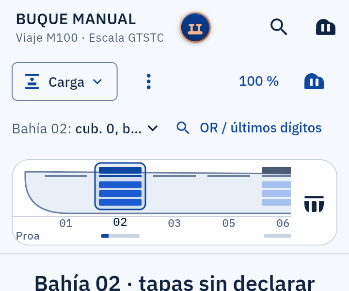

*Figura 40. Una carga registrada sin red: la nube dice «Sin conexión» y la cola espera.*

Los estados del chip:

| Chip | Qué significa |
|---|---|
| Solo este dispositivo | Sin cuenta: lo que registres se queda aquí |
| Conectando… | Buscando la nube |
| Al día | Todo lo registrado está en la nube |
| Enviando N | Hay N movimientos por subir |
| Sin conexión · N por enviar | Sin red; la cola espera |
| Sesión vencida: inicia sesión para enviar N | Hay que iniciar sesión de nuevo |
| Tu cuenta no está autorizada · N esperan | La cuenta existe pero no está activa |
| Revisar · N rechazados por la nube | La nube no aceptó esos movimientos: regístralos de nuevo si hacen falta |

### 7.11 Cerrar la operación

Al terminar la escala, la oficina pulsa **«Cerrar operación»** en «Nube y cuenta». La
app advierte: «Los movimientos registrados después del cierre se rechazarán. No se puede
volver a abrir.» Confirmada, la pantalla dice «Operación cerrada.», el estado pasa a
«Publicada y cerrada» y la operación deja de aparecer en «Operaciones abiertas en la
nube».

En el muelle, el cierre no se anuncia solo: su «Nube y cuenta» siguió diciendo «Publicada»
y «Al día», con «Fuentes: llegada · carga · listado r1», y solo «Operaciones abiertas en
la nube» cambió a «No hay operaciones abiertas.» Esta edición no registró ningún
movimiento después del cierre, así que no describe qué pasa con ese registro **(no
recorrido en esta edición)**; el chip «Revisar · N rechazados por la nube» de la tabla de
7.10 es lo que la app tiene previsto para un movimiento que la nube no acepta.

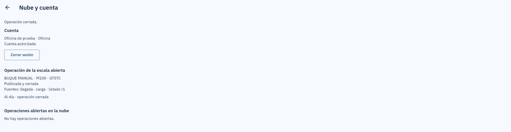

*Figura 41. La operación cerrada desde la oficina.*

## 8. Exportar y el BAPLIE de salida

### 8.1 Exportar PDF, CSV y JSON

«Más» → «Exportar PDF», «Exportar CSV» o «Exportar JSON». En Windows se abre «Guardar
reporte del viaje» con el nombre propuesto; en la Web lo descarga el navegador; en Android
lo entrega el sistema. Al terminar: «Exportación PDF completada». El PDF trae el reporte
con las bahías dibujadas; el CSV, una fila por contenedor con encabezados en español; el
JSON, el viaje completo. Con un previo sin confirmar, exportar pide confirmar antes.

### 8.2 El BAPLIE de salida

En la Lista, **«Generar BAPLIE de salida»**. La pantalla dice cuántos contenedores quedan a
bordo en la salida y los pendientes: «59 contenedores a bordo en la salida. Pendientes: 28
de carga y 28 de descarga. Puedes generar igual: la salida refleja lo registrado hasta
ahora. Las cargas pendientes y los cancelados quedan fuera; lo que todavía no se descargó
sigue a bordo.» Debajo, los cancelados vigentes y «Filas del listado que no cargaron»,
con «Copiar filas no cargadas».

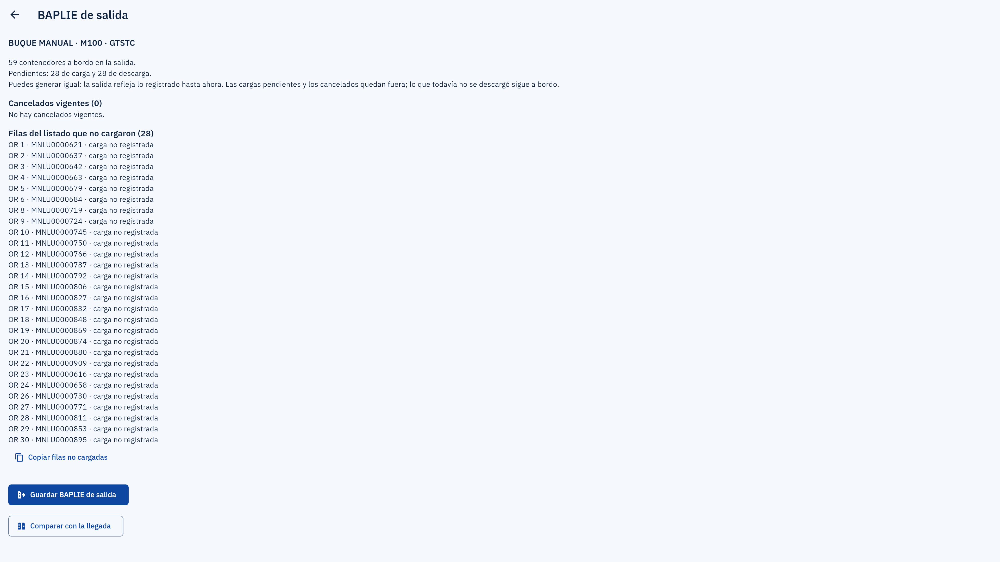

*Figura 42. El BAPLIE de salida con la operación a medias: lo que queda a bordo y lo que no cargó.*

- **«Guardar BAPLIE de salida»** guarda `BayStream_<buque>_<viaje>_salida.edi` con las
  reglas de 2.x (SMDG22). Si el plan de carga declara otro viaje que la operación, el
  archivo lleva el del plan y la pantalla lo dice.
- **«Comparar con la llegada»** compara la salida con el plano de llegada: «3 descargados ·
  2 cargados · 57 permanentes, 0 con cambios», con las pestañas Descargados, Cargados y
  Permanentes. «Comparar con otro BAPLIE…», en «Más», hace lo mismo con cualquier archivo.
- Con un plano en versión 1.5 no se genera la salida: hay que importar el plano en SMDG20,
  SMDG21 o SMDG22.

## 9. Claro y oscuro

«Parámetros» (la regla del riel, o «Más» en el teléfono) → «Tema de la aplicación»:
«Seguir al sistema», «Claro» u «Oscuro». «La elección se guarda en este dispositivo.
Seguir al sistema adapta el tema a sus cambios.» En la misma pantalla están «Mostrar el
panel lateral al pasar el mouse por el borde», «Política de privacidad» y «Parámetros del
buque» (el editor del perfil).

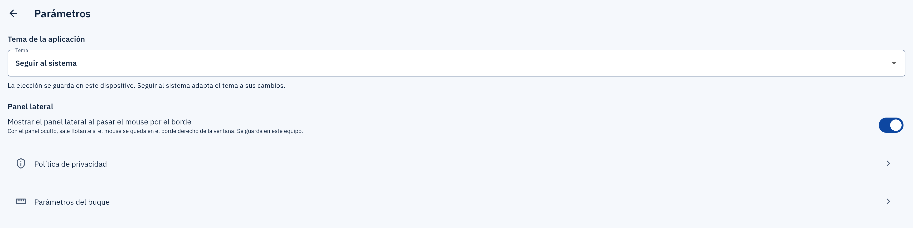

*Figura 43. Parámetros: el tema y el panel lateral.*

El oscuro es la noche de la oficina: fondo técnico con la rejilla del plano, paneles que
se apoyan en él y la bahía dibujada como el ícono.

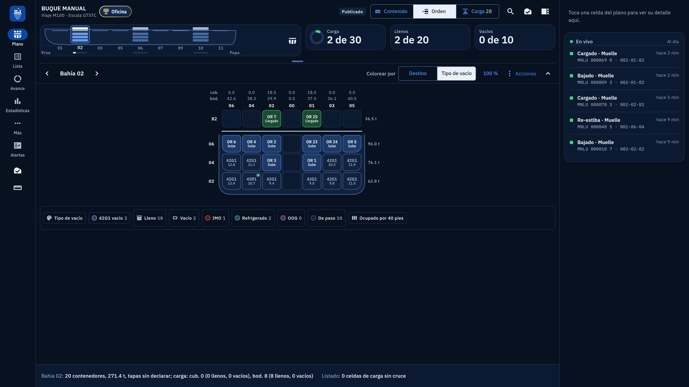

*Figura 44. El plano en tema oscuro, con las cargas registradas en verde.*

## 10. Mensajes y qué hacer

Todos los mensajes dicen la causa y la acción. Los más frecuentes:

| Mensaje | Qué hacer |
|---|---|
| Archivo «…»: Este archivo no parece un BAPLIE: no se reconoce su cabecera UNH/S009. Selecciona una exportación BAPLIE completa. | Elegiste otro tipo de archivo. Pide la exportación BAPLIE |
| Versión BAPLIE no admitida: la cabecera UNH declara … BayStream lee la familia 2.x (SMDG20, SMDG21 y SMDG22). Pide una exportación compatible. | Pide el BAPLIE en 2.x |
| Versión 1.5 (la cabecera UNH declara SMDG15), leída con las reglas de 2.x; revisa pesos y peligrosas | No es un error: revisa pesos y peligrosas; no habrá BAPLIE de salida |
| Pesos revisados en MEA / Posiciones mal formadas en LOC+147 / Dígito de control inválido en EQD / Archivo posiblemente incompleto | Los avisos de lectura de la Lista, con su acción en la tarjeta |
| Plano sin confirmar: perfil propuesto desde el archivo. Escala propuesta … | Pulsa «Confirmar», elige tu puerto y confirma el perfil |
| Peso por pila y tomas de refrigerado: sin evaluar hasta confirmar el perfil. | Confirma el perfil para que se evalúen |
| Falta resolver el límite de apilamiento: escríbelo o marca que no lo tienes. | Escribe «Límite por pila» o marca «No lo tengo» |
| ¿Descartar el plano sin confirmar? | «Seguir mirando» conserva el previo; «Descartar» lo cierra sin guardar |
| La escala … ya tiene una operación publicada (viaje …) sin plan de carga: confirma para agregarlo. | Confirma: el diálogo agrega el plan a la operación publicada |
| Esta escala todavía no tiene operación guardada: vuelve a abrir el BAPLIE de llegada y confirma la escala para registrar. | Abre el plano de llegada y confirma el puerto |
| Importa el listado de agencia para operar por OR. | La oficina importa el listado (7.8) |
| La celda la ocupa …, que baja en … y no se ha marcado. «Marcar su descarga y cargar» registra las dos cosas. | Confirma con ese botón o descarga primero |
| Fila N: … Corrige esa fila en el Excel y vuelve a importarlo. | La fila no se entendió; una fila de totales se puede ignorar |
| Falta elegir N equivalencias antes de importar. | Resuelve cada código pendiente con el lápiz |
| Sin cuenta, lo que registres se queda en este dispositivo. | Inicia sesión para publicar o unirte |
| Cuenta sin autorizar: lo que registres espera a que el responsable la active. | Pide al responsable que active la cuenta |
| No se pudo iniciar sesión: … | Revisa correo y contraseña; si se repite, avisa al responsable |
| Sin conexión · N por enviar | Sigue trabajando; al volver la red se envía solo |
| Los movimientos registrados después del cierre se rechazarán. No se puede volver a abrir. | Cierra solo al terminar la escala |
| Operación cerrada. | Ya no admite movimientos |
| No se pudo <operación> por un error interno de la aplicación; el detalle técnico quedó en el registro. Inténtalo de nuevo y, si se repite, reinicia la aplicación. | Reintenta; si sigue, reinicia y avisa al responsable |

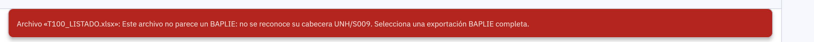

*Figura 45. El aviso al abrir un archivo que no es BAPLIE: la causa y la acción.*

## 11. Glosario

- **BAPLIE**: el mensaje EDIFACT con el plano de estiba de un buque. BayStream lee la
  familia 2.x; la 1.5 con aviso.
- **Bahía / Fila / Nivel**: las tres coordenadas de una posición. La bahía corre de proa a
  popa (pares para 40 pies, impares para 20); la fila, de banda a banda (00 en el centro,
  pares a un lado e impares al otro); el nivel, de abajo arriba (bodega desde 02, cubierta
  desde 82).
- **BBB-RR-TT**: la posición con siete dígitos, bahía, fila y nivel: «002-02-82».
- **Cubierta y bodega**: las dos zonas de la bahía; la frontera está en el nivel 80.
- **Tapa de escotilla**: la cubierta de la bodega. El BAPLIE no la declara; se declara en
  el perfil.
- **Sombra de 40 pies**: las celdas de las bahías impares vecinas que un 40 o 45 ocupa:
  «Ocupado por 40 pies».
- **Celda reservada**: una posición que el plan de carga reserva para un contenedor sin
  número todavía; los vacíos del listado se asignan ahí.
- **Escala**: el puerto de esta operación. Define qué se descarga, qué se carga y qué va
  de paso.
- **Previo**: el plano abierto sin confirmar. Se mira, no se opera, y no guarda nada.
- **Operación**: lo que se registra sobre una escala. Local hasta que la oficina la
  publica; cerrada cuando termina.
- **Fuentes**: los archivos de la operación: el plano de llegada, el plan de carga y el
  listado con su revisión.
- **De paso**: la carga que ni baja ni sube en esta escala.
- **Re‑estiba**: un contenedor de paso que sale del buque para volver a estibarlo; no
  cuenta entre los que bajan.
- **OR**: el número de orden del listado de la agencia, con el que el muelle identifica
  cada carga.
- **Listado de la agencia**: el Excel con los contenedores que se cargan: OR, tipo,
  puerto, línea y pesos.
- **VGM**: el peso bruto verificado. Cuando el archivo solo trae VGM, la app lo usa como
  peso.
- **IMDG / IMO / ONU**: el código marítimo de mercancías peligrosas; la clase IMO y el
  número ONU.
- **OOG**: carga sobredimensionada (fuera de medida).

---

### Lo no recorrido en esta edición

«Perfil del buque nuevo» y «Confirma la identidad del buque» (hace falta un segundo buque);
la pregunta «Tipo de BAPLIE» (solo aparece con cargas y descargas del mismo puerto en un
archivo); Atrás en Android (el teléfono se recorrió en la Web a 360 dp); el dictado; mover
con arrastre y las solicitudes de cambio; el reemplazo de un plan ya agregado; las tapas y
el orden de descarga (descritos en el manual de T-100, `docs/MANUAL-USUARIO.md`, que
sigue siendo válido para su anexo de la geometría a mano). Las capturas de la instalación
en Android y en la Web (figuras 5 y 6) las toma Carlos.
