# BayStream · Manual de usuario

Edición escrita sobre la app de `sprint3-cierre-2` (código `33404a5`), T-100 parte A,
20 y 21 de octubre de 2026. Las capturas están en `docs/manual/`: las que empiezan
con `w` son de Windows (1920 × 1080) y las que empiezan con `h`, del teléfono (360 dp).
Todas se tomaron con archivos de prueba sintéticos: ningún buque, viaje ni contenedor
de este manual es real.

Lo que todavía no está publicado se marca **PROVISIONAL**. Los procedimientos que no
se pudieron seguir en la app con los archivos de prueba se marcan **(no recorrido en
esta edición)**: su descripción sale de los textos de la propia app, no de haberlos
ejecutado. Al final están la lista de lo PROVISIONAL, los hallazgos y las limitaciones
de esta edición.

## Índice

1. Qué es BayStream y para quién
2. Cómo se instala y se abre: Windows, Android y la Web
3. Cómo se carga un BAPLIE
4. El perfil del buque
5. El plano
6. La Lista, los filtros, la búsqueda y el dictado
7. Estadísticas y Alertas de estiba
8. La operación
9. Nube y cuenta
10. Exportar: CSV, PDF y JSON
11. Modo claro y oscuro
12. Mensajes de error y qué hacer
13. Privacidad
14. Glosario

Anexo · La geometría a mano
Lista de lo PROVISIONAL, hallazgos y limitaciones

---

## 1. Qué es BayStream y para quién

BayStream lee un archivo BAPLIE (EDIFACT, familia 2.x) y lo convierte en lo que el
planificador necesita ver: el plano de estiba por bahías, la lista de contenedores,
las estadísticas del viaje y las alertas de estiba. Sobre ese plano se registra la
operación de una escala: descargas, cargas, re‑estibas, tapas y solicitudes de cambio
entre el muelle y la oficina.

Está pensada para dos personas:

- **El planificador de la oficina**, que conoce el BAPLIE y el plano impreso. Abre los
  archivos, confirma el perfil del buque, revisa alertas y estadísticas, y decide
  sobre las solicitudes del muelle.
- **El personal del muelle**, que registra lo que ocurre: qué contenedor bajó, cuál
  subió, qué tapa se quitó.

Lo que BayStream **no** hace: no inventa lo que el archivo no trae. El BAPLIE no
transmite la geometría del buque ni su límite de apilamiento; por eso la app los
pide y, si no los tienes, lo dice en pantalla en vez de suponer un número. Las
alertas de estiba son **apoyo a la decisión, no una verificación de cumplimiento**:
siempre lo repite el propio panel.

Funciona en tres sitios con la misma interfaz: la app de Windows, la app de Android y
la Web en el navegador. Todo lo que haces sin cuenta se queda en ese dispositivo.

## 2. Cómo se instala y se abre

### 2.1 Windows · PROVISIONAL

La app de Windows se entrega como un paquete MSIX firmado. Esta edición del manual
se escribió con una compilación de prueba abierta desde su carpeta, no con el
instalador, así que el procedimiento de instalación es el que dejó documentado la
tarea T-93 y **no se recorrió aquí**. Lo que llega a la PC: `BayStream.cer` (la parte
pública del certificado), `BayStream_<versión>.msix` y su `.sha256`.

1. Comprueba el paquete: en PowerShell, `Get-FileHash .\BayStream_<versión>.msix`
   tiene que dar el SHA-256 que trae el `.sha256`.
2. Confía en el certificado una sola vez, como administrador:
   `Import-Certificate -FilePath .\BayStream.cer -CertStoreLocation Cert:\LocalMachine\TrustedPeople`.
3. Instala: doble clic al `.msix` y «Instalar», o `Add-AppxPackage .\BayStream_<versión>.msix`.
4. Abre «BayStream» desde el menú Inicio.
5. Para actualizar, instala el `.msix` de la versión mayor encima: se conservan el
   viaje, los viajes recientes y la sesión.
6. Antes de desinstalar, sincroniza hasta «Al día» en Nube y cuenta y cierra la
   sesión: desinstalar borra el almacén privado del paquete.

En una PC sin BayStream previo, los datos viven en la carpeta privada del paquete.
Si la PC ya tenía la carpeta `%LOCALAPPDATA%\BayStream` (por una copia anterior de la
app), el paquete usa esa carpeta y no la borra al desinstalar.

**Al abrir**, la app muestra la pantalla de inicio: el icono del buque, «Cargar archivo
BAPLIE», el botón «Seleccionar archivo» y, abajo a la derecha, el botón flotante
«Cargar BAPLIE». En la barra superior están, de izquierda a derecha: «Viajes
recientes», «Perfiles guardados», «Nube y cuenta», «Parámetros» y «Cargar archivo
BAPLIE». Debajo del recuadro se lee «Contenido compatible: BAPLIE 2.x, y la 1.5 con
aviso».

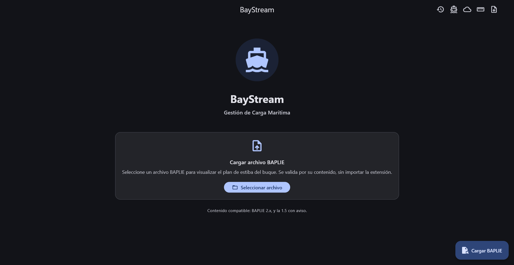

### 2.2 Android · PROVISIONAL

La app de Android está en la **prueba interna de Google Play**. Se instala desde la
tienda, con el enlace de prueba interna que entrega el responsable, y se abre como
cualquier otra app. La versión que corresponde a este manual (la del cierre
`sprint3-cierre-2`) todavía no está publicada en Play; esta edición se recorrió con
una app aparte instalada por cable en un Honor X5d con Android 15, a 360 dp.

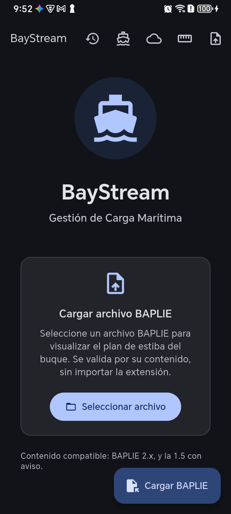

A 360 dp la barra superior no cabe entera: se ven «Viajes recientes», «Perfiles
guardados», «Nube y cuenta», «Buscar contenedor» y «Exportar viaje», y los demás
botones («Parámetros», «Cargar archivo BAPLIE» y «Limpiar datos») quedan a la
derecha, fuera del borde. **Desliza la barra hacia la izquierda con el dedo** para
llegar a ellos. Con un viaje abierto, en la pestaña «Plano» la barra se pliega y
aparece un chevrón a la derecha: tócalo («Desplegar acciones») para ver los botones.

### 2.3 La Web · PROVISIONAL

La Web está publicada en `baystream-app.web.app`. La versión de este manual (la
nueva, con los textos en español de T-112) **todavía no está publicada**: se
publicará después de la mezcla del sprint. Esta edición se recorrió con la compilación
Web servida en la propia máquina.

1. Abre `https://baystream-app.web.app` en Chrome.
2. La primera vez necesita conexión. Después de una visita completa, la Web vuelve a
   abrir sin red, con los viajes recientes guardados en el navegador.
3. La pantalla y los botones son los mismos que en Windows. El selector de archivos
   es el del navegador.

Lo que no promete la Web sin red: el dictado por voz ni datos nuevos de la nube.

## 3. Cómo se carga un BAPLIE

### 3.1 El selector

1. En la pantalla de inicio pulsa «Seleccionar archivo» o el botón flotante «Cargar
   BAPLIE». Con un viaje ya abierto, usa el botón «Cargar archivo BAPLIE» de la barra
   superior (el icono de la hoja con flecha).
2. Se abre el selector de archivos del sistema. En Windows es el diálogo
   «Seleccionar archivo BAPLIE»; en Android, el selector de documentos de Android,
   donde se llega al archivo desde «Mostrar raíces» → «Descargas» (o la carpeta donde
   esté).
3. Elige el archivo. La extensión no importa: **la app valida por el contenido**, así
   que un `.edi`, un `.txt` o un archivo sin extensión se leen igual.
4. Si el buque es nuevo, la app pasa a «Parámetros del buque» (capítulo 4). Si ya
   tiene perfil guardado, abre el viaje directamente y muestra el aviso
   «Archivo "nombre" cargado correctamente».

### 3.2 Las versiones admitidas

- **BAPLIE 2.x** (cabecera UNH con SMDG20, SMDG21 o SMDG22): se leen completas.
- **BAPLIE 1.5** (SMDG15): se lee con las reglas de 2.x y la tarjeta del viaje
  muestra el aviso «Versión 1.5 (la cabecera UNH declara SMDG15), leída con las
  reglas de 2.x; revisa pesos y peligrosas». Con esa versión no se genera el BAPLIE de
  salida (capítulo 8).
- **BAPLIE 3.1 y otras**: se rechazan con el mensaje «Versión BAPLIE no admitida: la
  cabecera UNH declara BAPLIE:D:13B:UN:SMDG31. BayStream lee la familia 2.x (SMDG20,
  SMDG21 y SMDG22). Pide una exportación compatible.»
- **Un archivo que no es BAPLIE** (un PDF, un Excel): «Este archivo no parece un
  BAPLIE: no se reconoce su cabecera UNH/S009. Selecciona una exportación BAPLIE
  completa.»

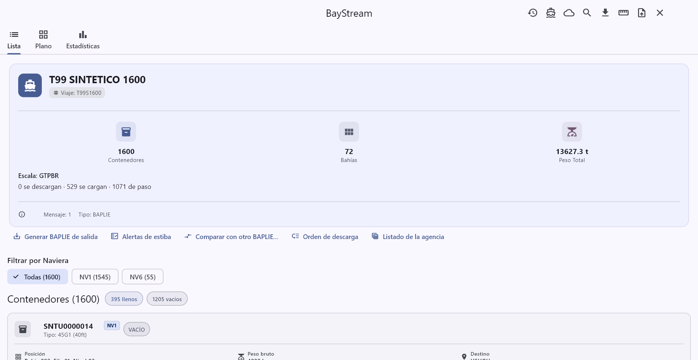

### 3.3 Los avisos de lectura

Cuando el archivo se lee pero trae algo que conviene revisar, la tarjeta del viaje
(pestaña «Lista») muestra una línea por tipo de aviso, con su cuenta y la acción:

| Aviso en la tarjeta | Qué significa | Qué hacer |
|---|---|---|
| Pesos revisados en MEA: N contenedores · revisa esos pesos antes de operar | Un peso venía sin unidad, o en libras o toneladas y se convirtió a kilos | Revisa esos pesos antes de operar |
| Posiciones mal formadas en LOC+147: N contenedores · pide una exportación corregida | La posición no tiene la forma BBBRRTT; el contenedor queda fuera de la rejilla, con su texto original en el detalle | Pide una exportación corregida |
| Dígito de control inválido en EQD: N contenedores · revisa esos números con la agencia | El número de contenedor no cuadra con su dígito ISO 6346 | Revisa esos números con la agencia |
| Archivo posiblemente incompleto: falta 1 segmento / faltan N segmentos (UNB, BGM, UNT, UNZ) | Faltan segmentos de sobre o de cierre | Pide la exportación completa |

Cada aviso tiene «Ver detalle», que abre la lista de contenedores afectados. Los
archivos sintéticos de esta edición no traen avisos, así que no hay captura de la
tarjeta con ellos.

### 3.4 Buques con el mismo nombre

Si ya hay perfiles guardados con el mismo nombre del buque, la app pregunta
«Confirma la identidad del buque»: el nombre por sí solo no identifica al buque.
Elige el perfil que corresponde o «Es otro buque». **(no recorrido en esta edición)**

### 3.5 Viajes recientes

El botón «Viajes recientes» (el reloj de la barra superior) lista los últimos **5**
viajes cargados en este dispositivo, con buque, número de viaje, contenedores y
bahías. Toca uno para reabrirlo **sin conexión ni archivo**. Al guardar el sexto se
elimina el más antiguo; los perfiles del buque se conservan. El icono de la papelera
pregunta «¿Eliminar …, viaje …, de este dispositivo? El perfil del buque se conserva.»

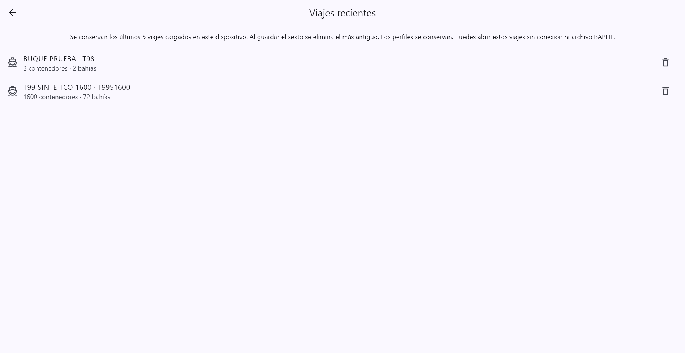

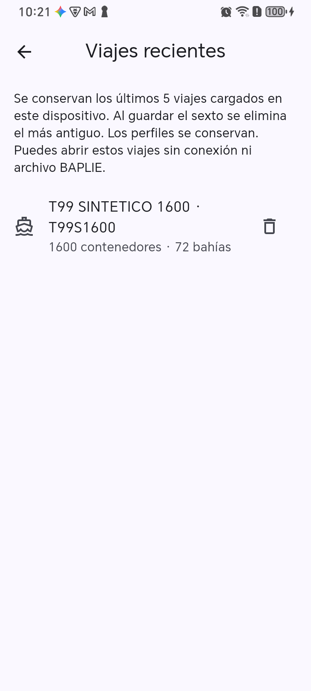

El botón «Limpiar datos» (la X de la barra superior, solo con un viaje abierto) cierra
el viaje en pantalla y vuelve al inicio. No borra el viaje de Recientes.

## 4. El perfil del buque

### 4.1 Por qué la app pregunta

El BAPLIE no transmite las dimensiones del buque: solo revela las posiciones que
este viaje trae ocupadas. Por eso la app propone **el mínimo observado** (las filas y
los niveles que aparecen en el archivo) y te pide confirmarlo. Un buque de catorce
filas que hoy carga en diez se ve, desde el archivo, como un buque de diez filas: los
valores propuestos se pueden subir sin restricción, pero bajarlos por debajo del
mínimo dejaría carga real fuera del plano, y la app no lo permite.

### 4.2 Perfil nuevo: «Perfil del buque nuevo»

Si el buque no tiene perfil y ya existe al menos un perfil guardado, antes de
«Parámetros del buque» aparece el diálogo «Perfil del buque nuevo: Elige un punto de
partida. Revisarás sus parámetros antes de guardar.» con dos opciones:

- «Proponer desde el archivo»: la propuesta sale solo del BAPLIE.
- «Plantilla: <buque>»: copia la geometría y las tomas de otro perfil. La pantalla
  siguiente avisa «Parámetros heredados de una plantilla para <buque>. Revisa si
  corresponden a este buque antes de confirmar.» y las tomas quedan marcadas como
  «Heredadas de plantilla; pendientes de declaración para este buque.»

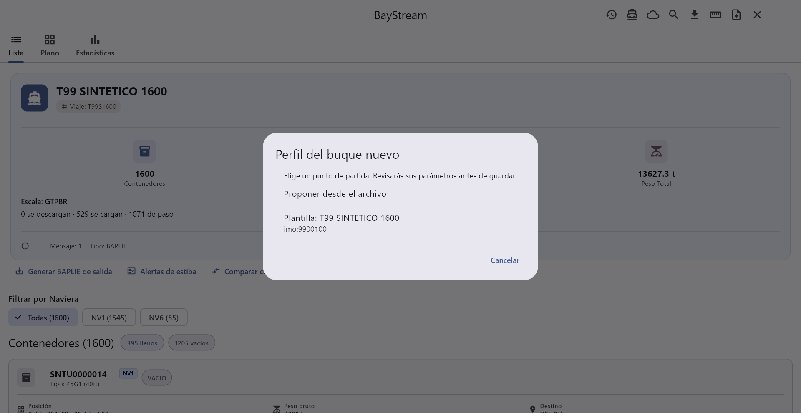

Si no hay ningún perfil guardado, se pasa directo a «Parámetros del buque».

### 4.3 La pantalla «Parámetros del buque», de arriba abajo

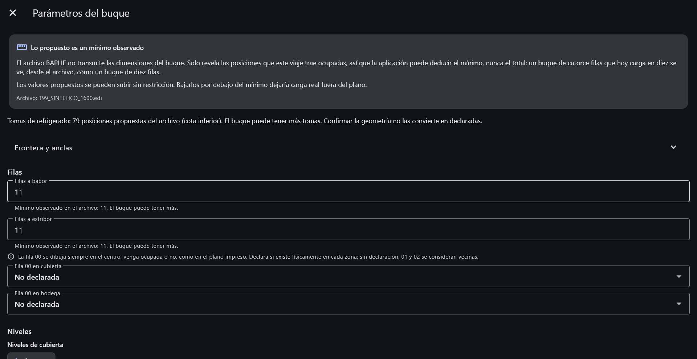

1. **«Lo propuesto es un mínimo observado»**: la explicación de 4.1 y el nombre del
   archivo.
2. **Tomas de refrigerado**: «N posiciones propuestas del archivo (cota inferior). El
   buque puede tener más tomas. Confirmar la geometría no las convierte en
   declaradas.»
3. **Frontera y anclas** (plegado; tócalo para desplegarlo): «Frontera cubierta /
   bodega» (80), «Primer nivel de bodega» (2) y «Primer nivel de cubierta» (82). «La
   frontera clasifica los niveles. Las anclas indican dónde empieza la propuesta de
   cada zona.» Son los valores de la numeración ISO; normalmente no se tocan.
4. **Filas**: «Filas a babor» y «Filas a estribor», cada una con su mínimo observado
   («Mínimo observado en el archivo: 11. El buque puede tener más.»). «Fila 00 en
   cubierta» y «Fila 00 en bodega» se declaran aparte: «La fila 00 se dibuja siempre
   en el centro, venga ocupada o no, como en el plano impreso. Declara si existe
   físicamente en cada zona; sin declaración, 01 y 02 se consideran vecinas.»
5. **Niveles**: «Niveles de cubierta» y «Niveles de bodega», como fichas. Las que
   trae el archivo no se pueden quitar («Este viaje trae carga en el nivel 02: no se
   puede quitar»); las demás tienen una X. «Agregar» ofrece el siguiente nivel
   («Nivel 82», «Nivel 08»).
6. **Puerto de esta escala**: fichas con los puertos del archivo y, entre paréntesis,
   cuántos contenedores se cargaron en cada uno; el declarado como puerto de salida
   viene marcado. Debajo, lo que esa elección significa: «0 se descargan · 529 se
   cargan · 1071 de paso». «Sin declarar» deja el plano sin distinguir la carga de paso.
7. **Límite de apilamiento**: «Este dato no está en el archivo. Viene del manual de
   estabilidad del buque.» Escribe «Límite por pila» en kg, o marca «No lo tengo»:
   «Sin límite declarado no se muestra ninguna alerta de peso. La aplicación no
   inventa un umbral.» Hasta resolverlo, el botón de confirmar queda apagado y abajo
   dice «Falta resolver el límite de apilamiento: escríbelo o marca que no lo tienes.»
8. **Tomas de refrigerado (N)** (plegado): el anexo explica cómo cargarlas.
9. **Tapas: sin declarar** y el botón «Editar tapas por bahía»: también en el anexo.
10. **Rejilla resultante**: «23 columnas × 3 niveles = 69 huecos por bahía», y si el
    perfil cambió respecto de lo propuesto.
11. **«Confirmar y ver el plano»** y «Cancelar la carga». Cancelar descarta el viaje:
    «Carga cancelada: no se confirmó la geometría del buque».

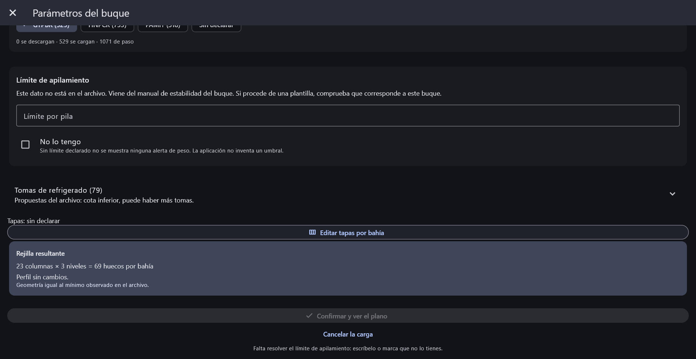

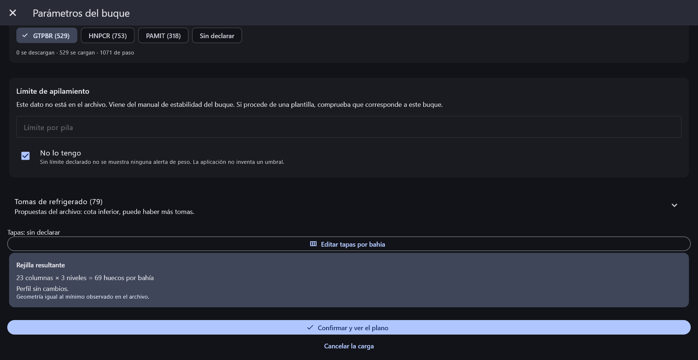

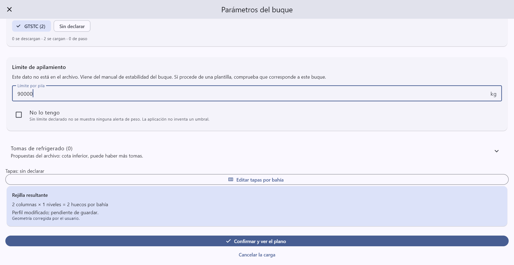

En el teléfono la pantalla es la misma, en una sola columna:

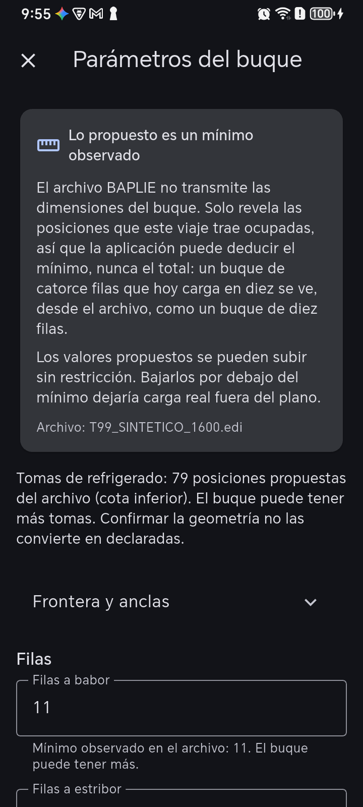

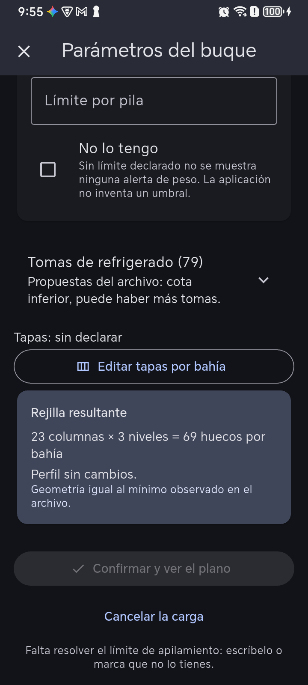

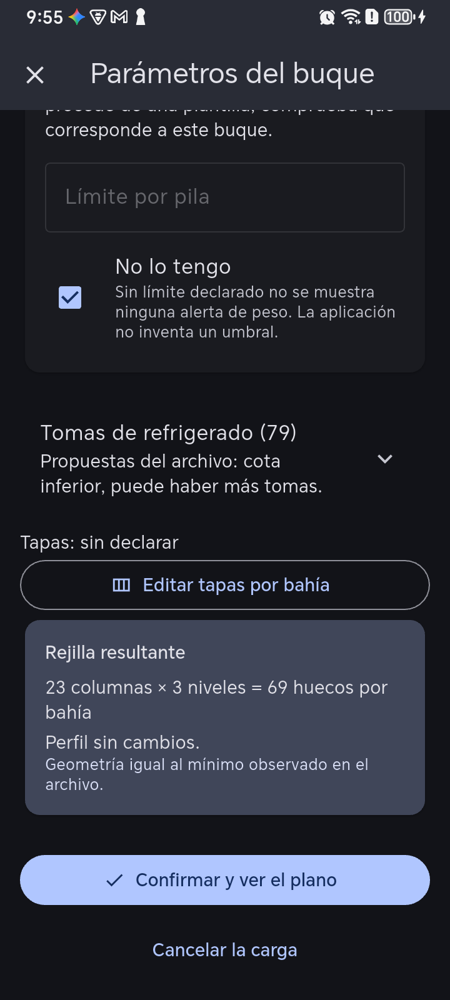

### 4.4 Confirmar

1. Resuelve el límite de apilamiento (escríbelo o marca «No lo tengo»).
2. Revisa el puerto de la escala.
3. Pulsa «Confirmar y ver el plano». El perfil se guarda y el viaje se abre.
   **Hallazgo conocido:** el botón abre la pestaña «Lista», no la «Plano» (decisión
   10.97; va al Sprint 4). Toca «Plano» para ver el plano.
4. Si para el puerto elegido hay cargas y descargas y el archivo no dice qué plano
   es, aparece «Tipo de BAPLIE: En <puerto> hay N cargas y M descargas. Indica qué
   plano representa este archivo.» con «Llegada» y «Carga». Con los archivos de esta
   edición el diálogo no apareció, porque no tienen descargas **(no recorrido en esta
   edición)**.

### 4.5 «Perfiles guardados» y editar un perfil

El botón «Perfiles guardados» (el buque de la barra superior) lista los perfiles con
su clave (`imo:…`). El lápiz abre «Parámetros del buque» para ese perfil, con el
aviso «Editando el perfil guardado de <buque>. Los cambios se guardan solo al
confirmar.» y los botones «Guardar perfil» y «Cancelar». Con un viaje abierto, el
mismo editor se alcanza desde «Parámetros» → «Parámetros del buque».

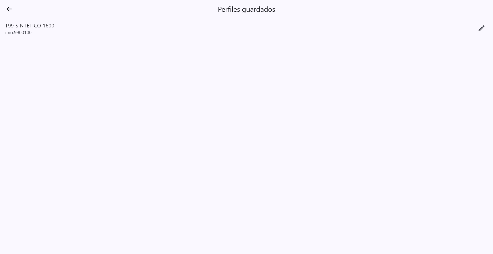

Si un viaje nuevo trae posiciones fuera del perfil guardado, la app avisa «La carga
excede el perfil guardado» y ofrece «Revisar ampliación» o «Cancelar carga»
**(no recorrido en esta edición)**.

## 5. El plano

### 5.1 Qué se ve

Toca la pestaña «Plano».

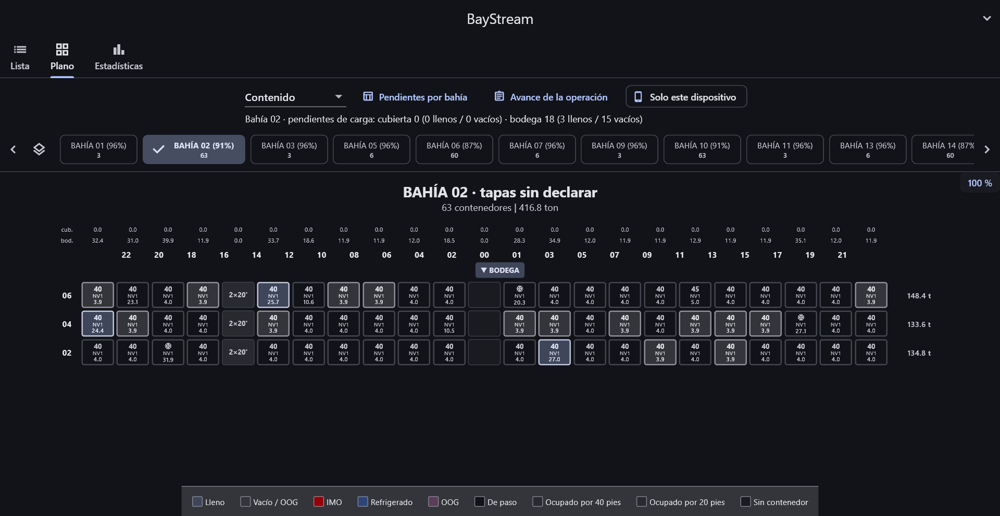

- **Arriba**: el menú «Contenido» (qué muestra cada celda), «Pendientes por bahía»,
  «Avance de la operación» y el chip «Solo este dispositivo» (el estado de la nube,
  capítulo 9). Debajo, la línea de resumen de la bahía: «Bahía 02 · pendientes de
  carga: cubierta 0 (0 llenos / 0 vacíos) · bodega 18 (3 llenos / 15 vacíos)».
- **El selector de bahías**: fichas «BAHÍA 02 (91%)» con el número de contenedores
  debajo, y las flechas «Anterior» y «Siguiente». A la izquierda, el icono de capas
  abre «Tapas en la operación» (capítulo 8). El porcentaje es la ocupación contra la
  geometría del perfil.
- **El título**: «BAHÍA 02 · tapas sin declarar» (o las tapas declaradas), y
  «63 contenedores | 416.8 ton».
- **La rejilla**: las **filas** en el eje horizontal, pares a un lado y 00 e impares al
  otro, como en el plano impreso; los **niveles** en el vertical, con «▲ CUBIERTA»
  arriba y «▼ BODEGA» abajo. Sobre cada fila, dos cifras: «cub.» y «bod.», el peso en
  toneladas de esa pila en cubierta y en bodega. A la derecha de cada nivel, su peso.
- **Cada celda** dice el tamaño (20, 40, 45), la naviera y el peso en toneladas. Un copo
  de nieve es un refrigerado; el borde rojo, una mercancía peligrosa (IMO).
- **La leyenda** de abajo: Lleno, Vacío / OOG, IMO, Refrigerado, OOG, De paso,
  Ocupado por 40 pies, Ocupado por 20 pies, Sin contenedor, y «Celda reservada» cuando
  el archivo trae reservas.

### 5.2 Las sombras de los 40 pies

Un contenedor de 40 o 45 pies se estiba en una bahía par y ocupa también las dos
impares vecinas. La app lo dibuja así: en la bahía par aparece el contenedor; en las
impares, la celda sale como «Ocupado por 40 pies» (la sombra) y la bahía figura en el
selector aunque no tenga carga propia. Al revés, dos de 20 en las impares aparecen en
la par como «2×20'» («Ocupado por 20 pies»).

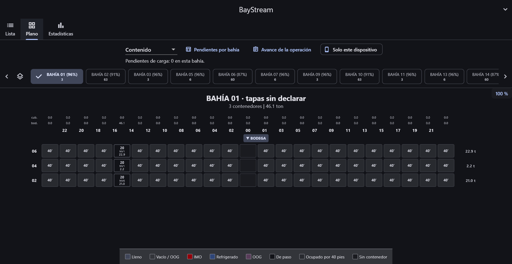

### 5.3 Cubierta y bodega

El archivo de prueba de este capítulo solo trae bodega. Con un archivo que trae
cubierta, la zona «▲ CUBIERTA» se dibuja arriba, con sus niveles 82, 84…:

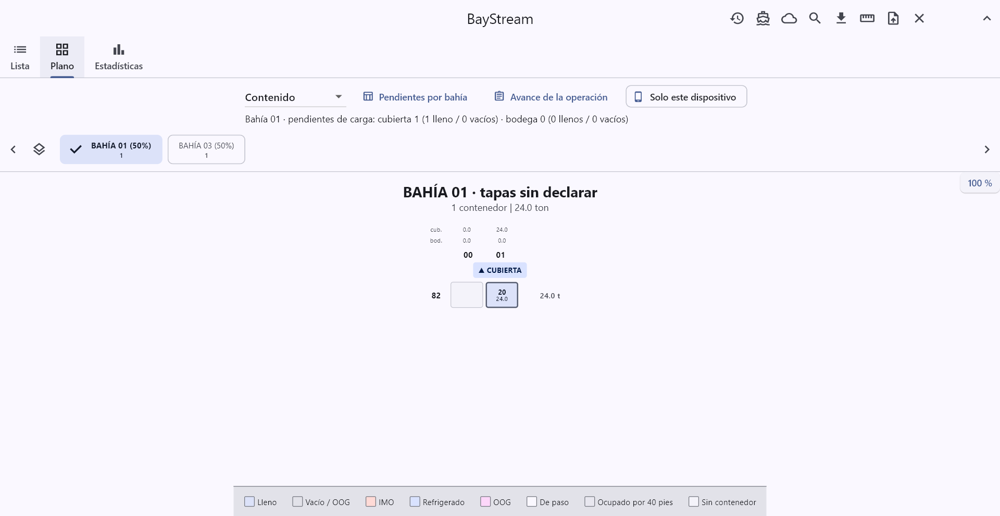

### 5.4 El detalle de una celda

Toca una celda. Se abre el detalle: número de contenedor, naviera, «Posición» como
«Bahía 002, Fila 03, Nivel 02», «Tipo ISO», «Estado» (LLENO / VACÍO / Desconocido),
«Peso bruto» o «Peso (VGM)» («El archivo no trae peso» si falta), «Puerto Carga» y
«Puerto Descarga»; si aplica, «CARGA PELIGROSA - IMO <clase>» con «UN: <número>» y
«REFRIGERADO: <temperatura>». «Cerrar» vuelve al plano.

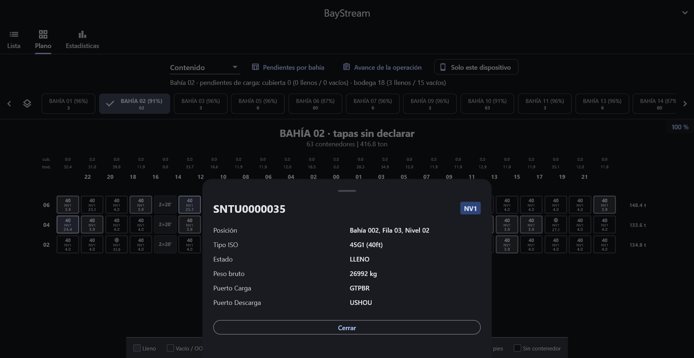

### 5.5 El zoom

1. Toca el rótulo «100 %» arriba a la derecha de la rejilla.
2. Aparecen «Alejar plano» (−), «Restablecer zoom del plano» (el porcentaje),
   «Acercar plano» (+) y «Cerrar controles de zoom» (×).
3. Acerca hasta el 300 % o aleja hasta el 75 %, de paso en paso. Con el plano
   ampliado, la rejilla se desplaza con la barra o con el dedo.

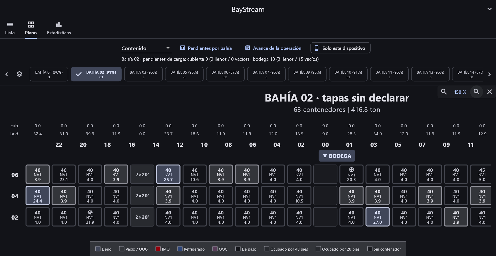

### 5.6 El plano en el teléfono y la letra grande

A 360 dp la rejilla se desplaza en horizontal con el dedo, igual que el selector de
bahías y la leyenda. «Contenido», el menú «Acciones» (con «Pendientes por bahía» y
«Avance de la operación») y el icono del teléfono (la nube) ocupan la primera línea.

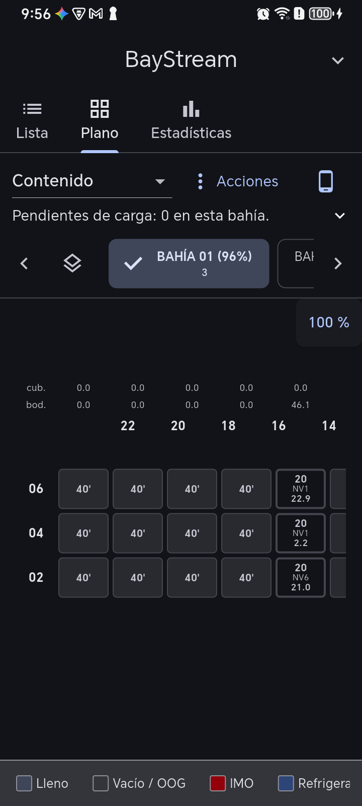

La app respeta el tamaño de letra del sistema. Con la letra grande de Android (1.45)
todo crece y hay más que desplazar: la línea de resumen se corta con «…» y la leyenda
deja «Refrigera…» en el borde. Es un comportamiento conocido (10.94).

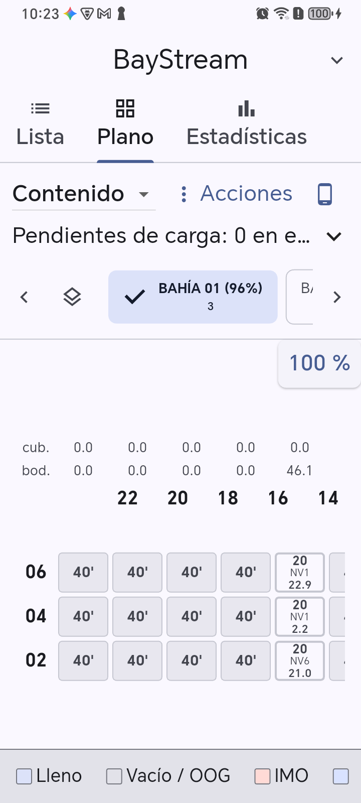

### 5.7 El contenido de las celdas

El menú «Contenido» cambia lo que dibuja cada celda:

- «Contenido»: tamaño, naviera y peso (lo normal).
- «Número de orden»: el OR del listado de la agencia, cuando está importado.
- «Carga»: los pendientes de carga de la escala, con una flecha hacia arriba.
- «Descarga»: los pendientes de descarga, solo cuando la operación tiene plano de
  llegada.

## 6. La Lista, los filtros, la búsqueda y el dictado

### 6.1 La Lista

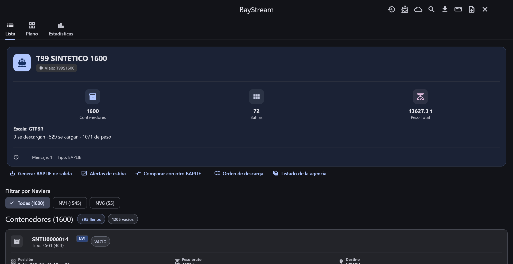

De arriba abajo:

1. **La tarjeta del viaje**: buque, «Viaje: <número>» («sin número» si el archivo no
   lo trae), «Contenedores», «Bahías», «Peso Total», «Escala: <puerto>» y el reparto
   «0 se descargan · 529 se cargan · 1071 de paso», más «Mensaje» y «Tipo». Aquí salen
   también los avisos de lectura (3.3) y, si hay reservas, «N contenedores · M celdas
   reservadas».
2. **Los botones de la operación**: «Generar BAPLIE de salida», «Alertas de estiba»,
   «Comparar con otro BAPLIE…», «Orden de descarga» y «Listado de la agencia»
   (capítulos 7 y 8). Los dos últimos solo aparecen cuando aplican.
3. **«Filtrar por Naviera»**: fichas «Todas (1600)», «NV1 (1545)»… Toca una para
   filtrar la lista; toca «Todas» o la misma ficha para quitar el filtro.
4. **«Contenedores (N)»** con las cuentas de «llenos» y «vacíos» del filtro vigente.
5. **Una tarjeta por contenedor**: número, naviera, LLENO / VACÍO, tipo, «Posición»
   («Bahía 006, Fila 10, Nivel 02» o «Sin asignar»), peso y «Destino». Toca la tarjeta
   para ver el detalle completo (los mismos campos de 5.4).

Con un viaje pequeño se ve entera, con sus dos tarjetas de contenedor:

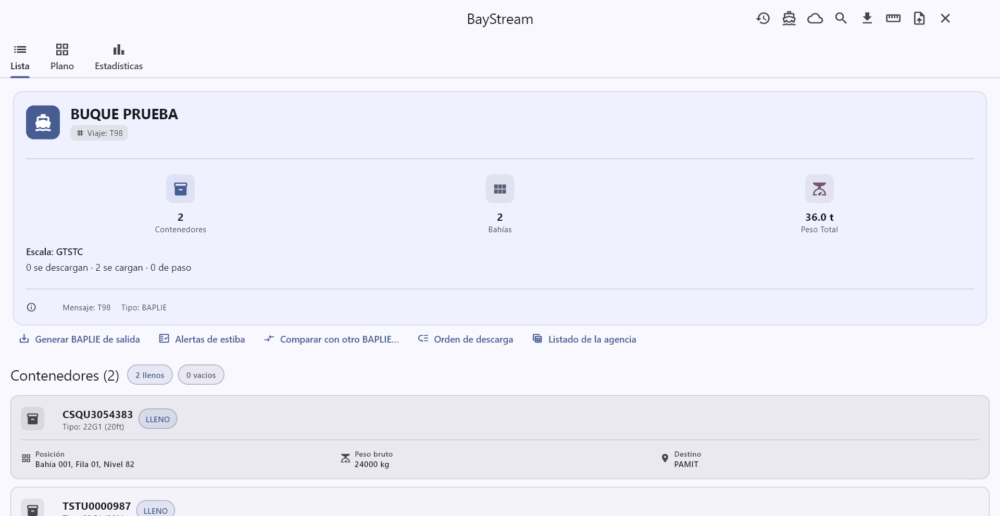

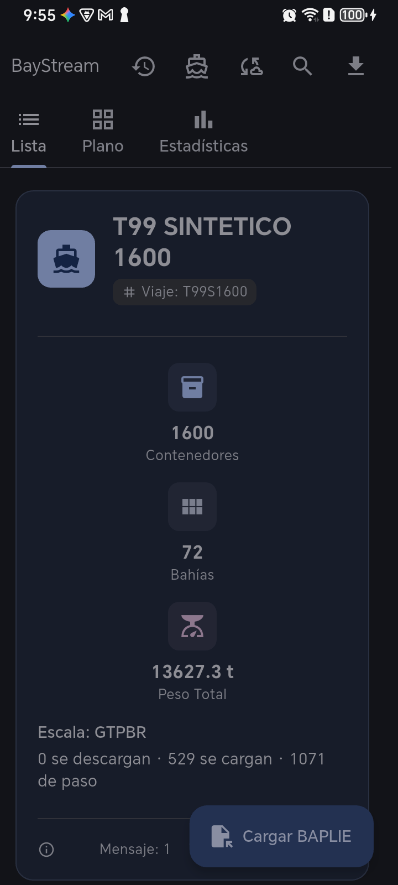

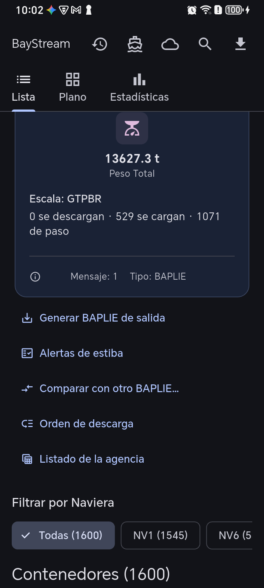

### 6.2 La búsqueda

1. Toca «Buscar contenedor» (la lupa de la barra superior).
2. Sin escribir nada, la pantalla muestra «1600 contenedores disponibles · Busca por
   ID, puerto de descarga o naviera», las fichas «Navieras en este viaje» y «Puertos
   de descarga», y el consejo «Escribe parte del ID del contenedor (ej: "MSKU123")
   para encontrarlo rápidamente».
3. Escribe parte del número, un puerto o una naviera. La lista se filtra mientras
   escribes y resalta la parte que coincide. Cada resultado trae naviera, «POD»,
   «Posición» y el peso.
4. Toca un resultado: la app abre la pestaña «Plano» en la bahía del contenedor y lo
   resalta con un borde de color.

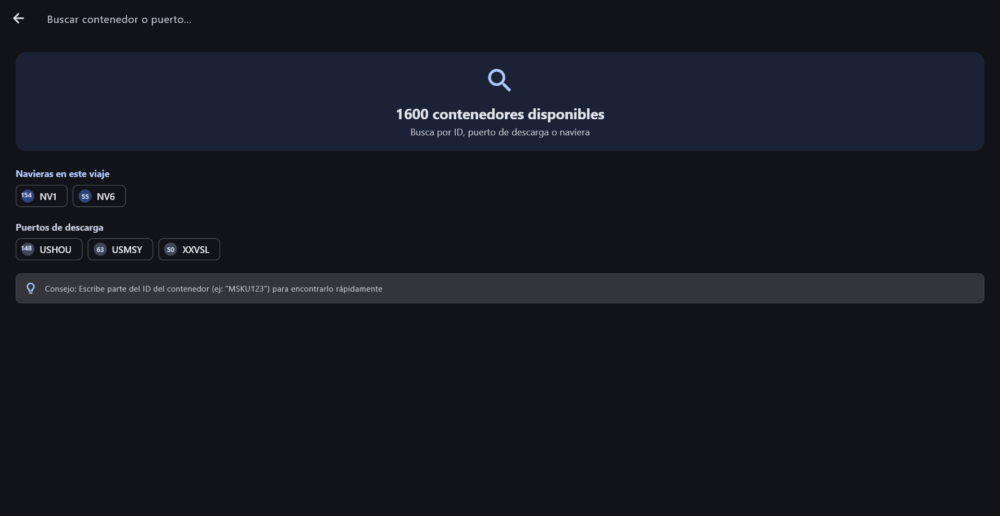

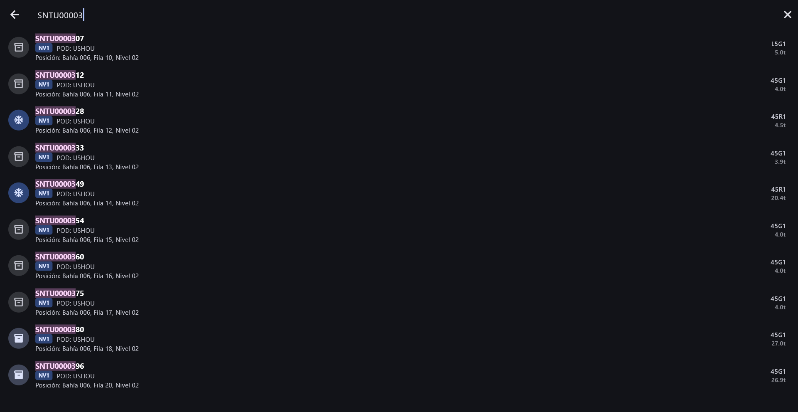

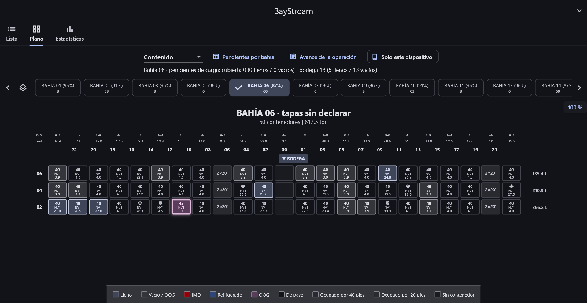

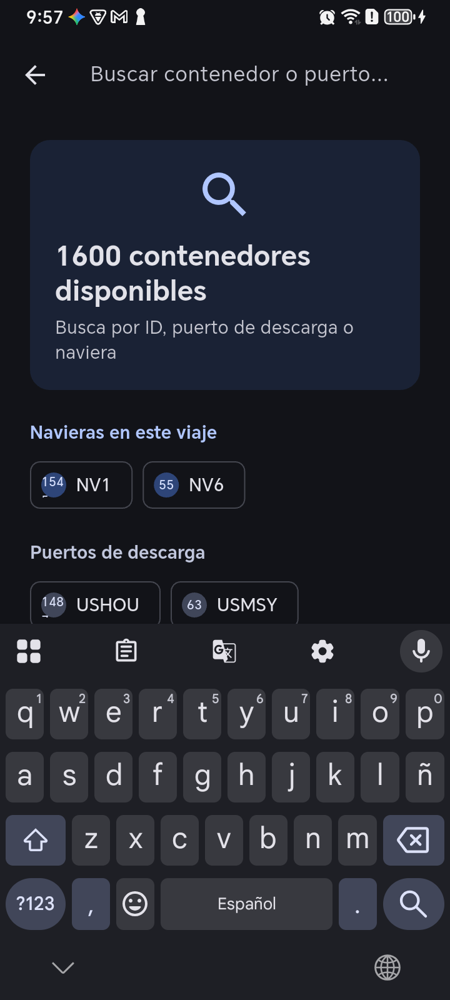

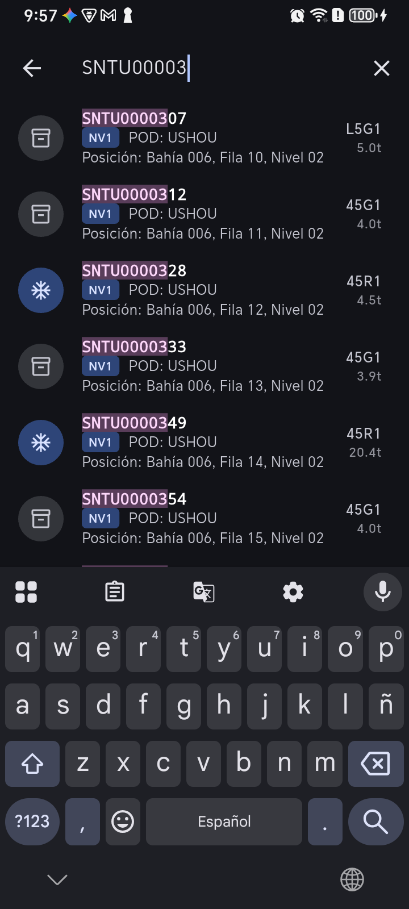

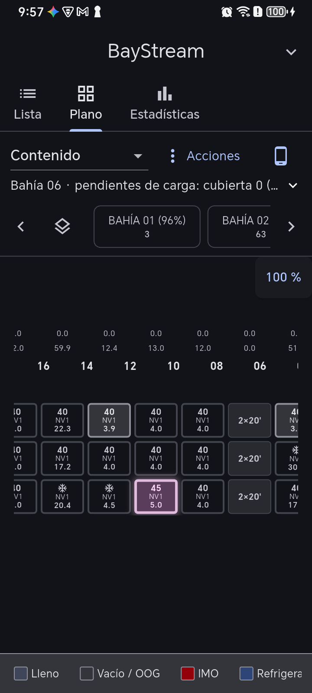

### 6.3 El dictado (Android)

El dictado está en el selector de la operación de carga, no en la lupa: al confirmar
una carga «por OR o contenedor» (capítulo 8), el campo «OR o últimos dígitos» lleva un
micrófono, «Dictar búsqueda en español».

1. Toca el micrófono. La primera vez, Android pide permiso para usar el micrófono.
2. La app muestra «Escuchando…». Di el OR o el número, letra por letra y cifra por
   cifra: «te ese te u cero cero cero uno dos tres cuatro» se convierte en
   `TSTU0001234`. Vale «doble u», «i griega», «be larga» y «ve corta».
3. Lo reconocido entra como **borrador**: «Borrador: revisa o corrige y pulsa
   Buscar.» Corrige si hace falta y pulsa «Buscar» (o la lupa del teclado). Hasta
   entonces no se busca ni se registra nada.
4. «Detener dictado» corta la escucha.

Si el dictado no está disponible, la app lo dice y deja escribir: «Permiso de
micrófono denegado. Puedes escribir la búsqueda.», «Reconocimiento sin conexión o
servicio no disponible…», «No se entendió el dictado. Reintenta o escribe la
búsqueda.», «Reconocimiento en español no disponible…» o «Reconocimiento de voz no
disponible…». En Windows y en la Web el dictado no está disponible y aparece ese
último mensaje. **(no recorrido en esta edición:** el selector de carga por OR exige
un listado de la agencia importado, y no se concedió el permiso del micrófono).

## 7. Estadísticas y Alertas de estiba

### 7.1 Estadísticas

Toca la pestaña «Estadísticas».

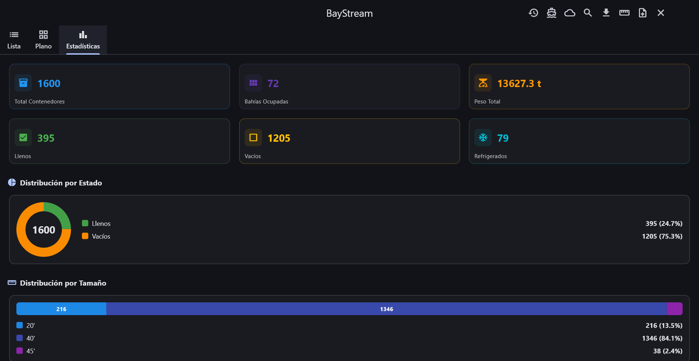

- **Las tarjetas**: «Total Contenedores», «Bahías Ocupadas», «Peso Total», «Llenos»,
  «Vacíos», «Refrigerados» e «IMO / DG». Las bahías que solo tienen reservas o sombra
  de 40 no cuentan como ocupadas.
- **«Distribución por Estado»** (llenos, vacíos, sin estado), **«Distribución por
  Tamaño»** (20', 40', 45'), **«Carga Especial»** (refrigerados e IMO),
  **«Distribución por Naviera»** y **«Distribución por Puerto de Descarga»**.
- **«Perfil longitudinal»**: las bahías de proa a popa, con el conmutador
  «Ocupación» / «Peso». Toca una barra para abrir esa bahía en el plano («Abrir bahía
  NN en el plano»).
- **«Contenedores por Bahía»** y **«Peso por Bahía (toneladas)»**.

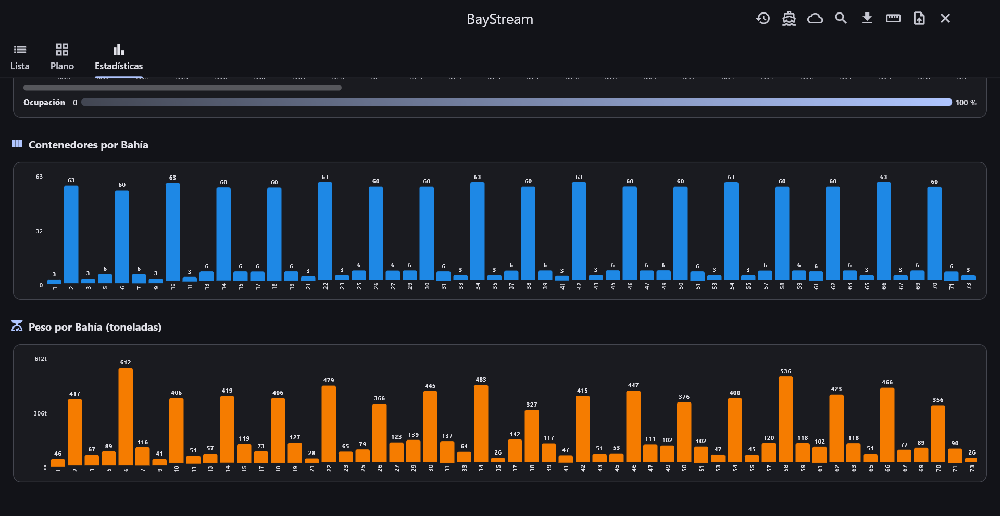

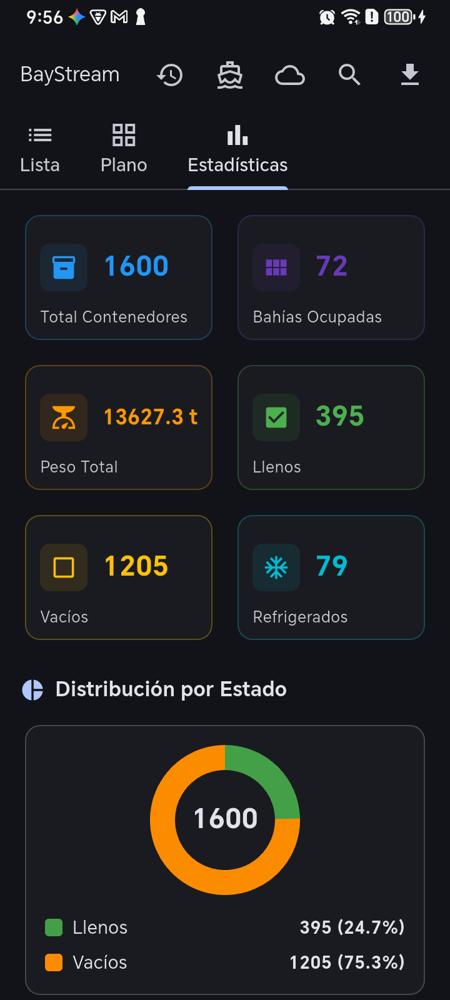

### 7.2 Alertas de estiba

En la Lista, pulsa «Alertas de estiba».

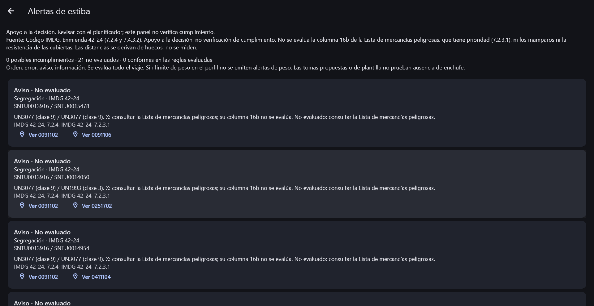

Lo primero que dice la pantalla es lo que hay que recordar: «Apoyo a la decisión.
Revisar con el planificador; este panel no verifica cumplimiento.» La fuente es el
Código IMDG, Enmienda 42-24 (7.2.4 y 7.4.3.2); **no se evalúa la columna 16b** de la
Lista de mercancías peligrosas, que tiene prioridad, ni los mamparos ni la resistencia
de las cubiertas; las distancias se derivan de huecos, no se miden.

Debajo, el resumen «N posibles incumplimientos · M no evaluados · K conformes en las
reglas evaluadas» y el orden «error, aviso, información».

Las reglas que evalúa:

| Regla | Cuándo se evalúa | Si no se puede |
|---|---|---|
| Peso por pila | Con un límite de apilamiento en el perfil | «Sin límite de peso en el perfil no se emiten alertas de peso» |
| Toma de refrigerado | Con tomas declaradas por el usuario | «Las tomas propuestas o de plantilla no prueban ausencia de enchufe» |
| 20 pies sobre 40 pies | Siempre | — |
| Segregación · IMDG 42-24 | Entre pares de mercancías peligrosas, por clase | «X: consultar la Lista de mercancías peligrosas; su columna 16b no se evalúa» |

Cada alerta trae «Aviso · No evaluado» (o «Error · Posible incumplimiento»,
«Información · Conforme en las reglas evaluadas»), la regla, los contenedores, la
explicación con su referencia y los botones «Ver <posición>», que abren el plano en esa
celda. «No hay resultados para mostrar. Esto no declara el viaje conforme.» es lo que
dice cuando no hay nada que evaluar.

Un caso para saberlo: dos aerosoles UN1950 que una norma extranjera aprobaba por
excepción salen aquí como «posible incumplimiento» con la clase declarada, porque la
columna 16b queda fuera. Es apoyo a la decisión: la decide el planificador.

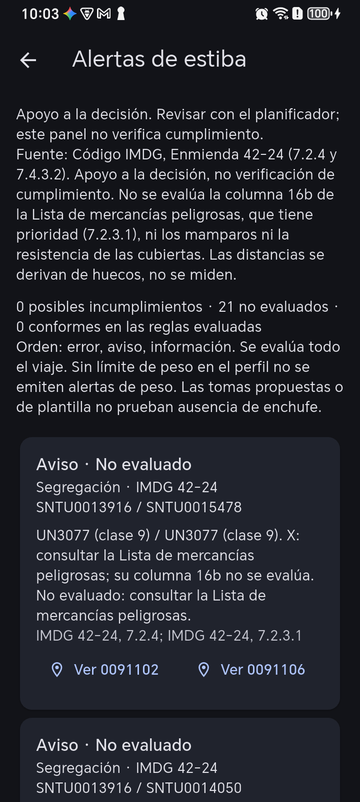

## 8. La operación

La operación es lo que se registra sobre una escala: descargas, cargas, re‑estibas,
tapas y solicitudes de cambio. Se guarda en el dispositivo y, con cuenta, se publica
en la nube (capítulo 9). Todo lo que se registra queda en una bitácora que solo
anexa: deshacer un movimiento no lo borra, lo anula con su motivo.

### 8.1 Cargas y descargas: los pendientes

El plano con «Contenido» en «Carga» muestra las celdas pendientes de carga con una
flecha y, arriba, el resumen de la escala:

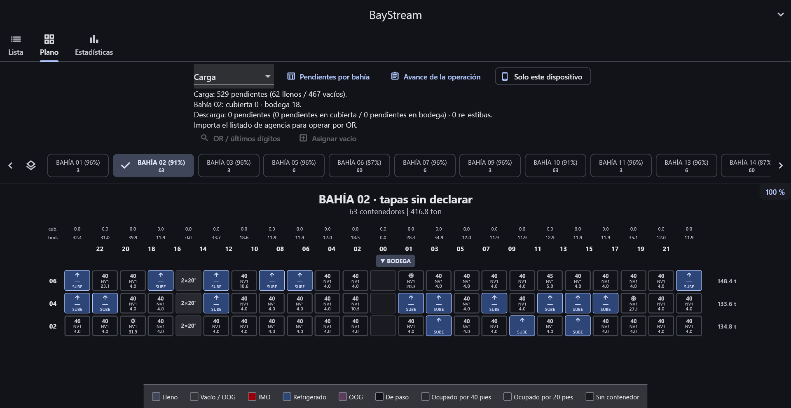

- «Carga: 529 pendientes (62 llenos / 467 vacíos).»
- «Bahía 02: cubierta 0 · bodega 18.»
- «Descarga: 0 pendientes (0 pendientes en cubierta / 0 pendientes en bodega) · 0
  re‑estibas.»
- «Importa el listado de agencia para operar por OR.»
- El campo «OR / últimos dígitos» y el botón «Asignar vacío».

«Pendientes por bahía» abre la tabla «Pendientes de carga · <buque> · <viaje> ·
<escala>»: por bahía, «Cub. L», «Cub. V», «Bod. L», «Bod. V» y «Total», con la
leyenda «Cub. = cubierta; Bod. = bodega; L = llenos; V = vacíos.» y «Sin listado: F/E
según el plan.»

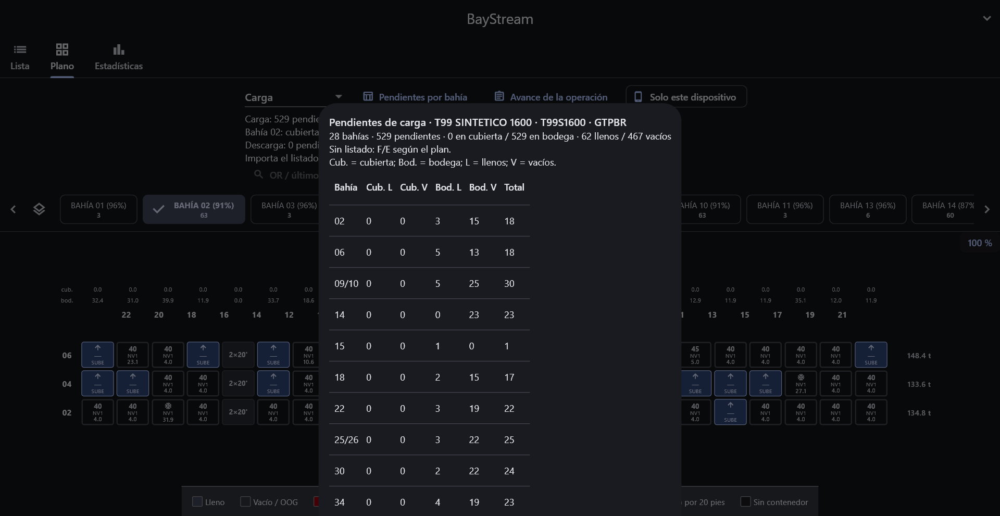

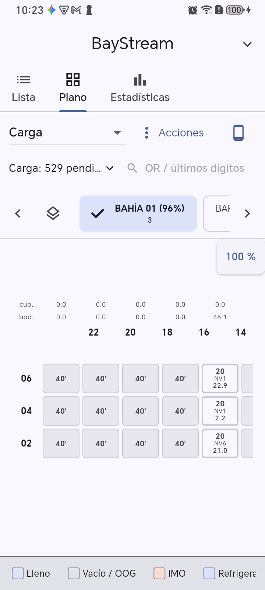

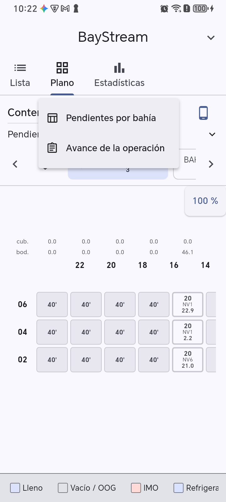

**Registrar una carga** **(no recorrido en esta edición)**: en modo «Carga», toca una
celda pendiente. Se abre «Confirmar carga por OR o contenedor»: busca por OR o por
los últimos dígitos (o dicta, 6.3), elige la fila y confirma con «Confirmar carga».
«Asignar vacío» hace lo mismo con los vacíos del listado. Si la celda donde quedó no
es la planificada, el formulario pide la celda («Celda donde quedó (opcional)», en
BBB-RR-TT) y un motivo. Después de registrar aparece «Deshacer» unos segundos; si ya
pasó, se corrige desde el detalle de la celda.

**Registrar una descarga** **(no recorrido en esta edición:** los archivos de prueba no
tienen descargas): con un plano de **llegada** («Tipo de BAPLIE» → «Llegada»), el
modo «Descarga» muestra «Toca un contenedor para marcarlo como descargado.» Si el
contenedor no baja en esta escala, la app pregunta si es una **re‑estiba**:
«<contenedor> no se descarga en <puerto>: va a <puerto de descarga>. Si sale del buque
para volver a estibarlo, se registra como re‑estiba y no cuenta entre los que
bajan aquí.», con «Motivo (opcional)» y «Registrar re‑estiba». «Pendientes de
descarga» abre la tabla por bahía («Cub.», «Bod.», «Total», «Desc.», «Re‑est.»). Si
la escala no tiene operación guardada, la app lo dice: «Esta escala todavía no tiene
operación guardada: vuelve a abrir el BAPLIE de llegada y confirma la escala para
registrar.»

**«Avance de la operación»** (desde el plano o desde «Acciones»): una tabla por bahía
con «Descarga», «Carga · llenos», «Carga · vacíos», «Cancelados», «Conflictos»,
«Tapas PROVISIONAL» y «Último movimiento», más la fila «TOTAL». Debajo, «Conflictos»
(con «Ir a <posición>»), «Peso de las pilas» («No evaluado: el perfil no declara
límite de pila» si no hay límite) y los movimientos repetidos.

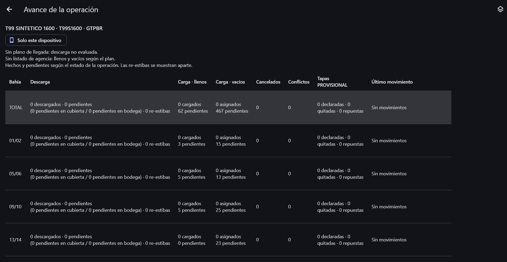

### 8.2 Las tapas en la operación

El icono de capas del selector de bahías abre «Tapas en la operación»: «PROVISIONAL ·
Estado derivado de la bitácora. Registra lo observado en muelle u oficina.» Elige la
bahía; si el perfil no declara tapas, dice «Tapas sin declarar. No se generan
avisos.» Con tapas declaradas (anexo), cada una tiene «Quitar» y «Reponer», y al
descargar de bodega bajo una tapa puesta la app avisa «Tapa puesta · <tapa>» con
«Seguir sin quitarla» o «Quitar tapa y continuar».

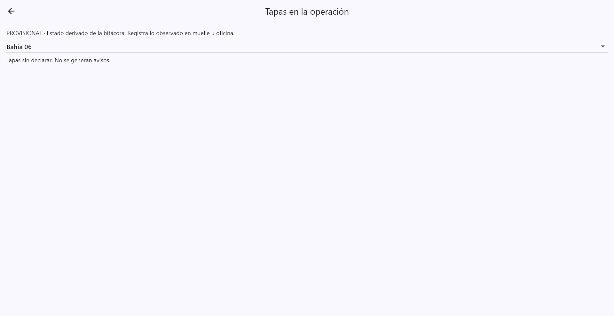

### 8.3 El orden de descarga

En la Lista, «Orden de descarga» (aparece cuando el archivo trae puertos de descarga
y la geometría está confirmada).

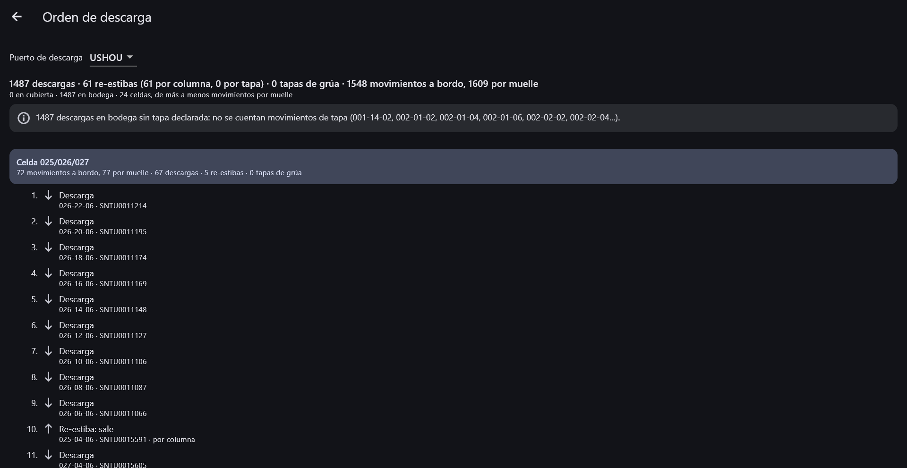

1. Elige el «Puerto de descarga» en el desplegable (la escala sale marcada).
2. El resumen: «1487 descargas · 61 re‑estibas (61 por columna, 0 por tapa) · 0
   tapas de grúa · 1548 movimientos a bordo, 1609 por muelle», y cuántos van en
   cubierta y en bodega.
3. Los avisos de lo que no entra en la secuencia: descargas en bodega sin tapa
   declarada, contenedores sin posición o sin puerto, declaraciones repetidas.
4. Una tarjeta por **celda** (por ejemplo «Celda 025/026/027», las tres bahías de
   un 40) con sus movimientos, y la lista numerada: «Descarga» o «Re‑estiba: sale» /
   «Re‑estiba: vuelve», con la posición y el contenedor, y «por columna» o «por tapa»
   cuando la re‑estiba la provoca uno u otra.

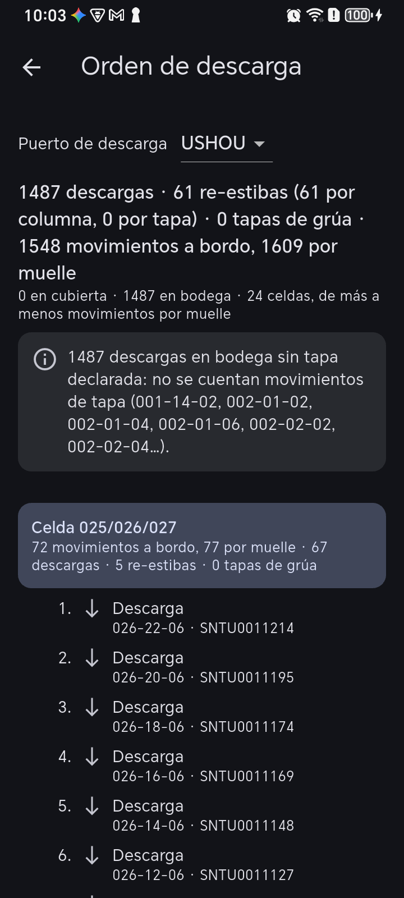

### 8.4 Arrastrar para mover y las solicitudes de cambio

**Arrastrar** **(no recorrido en esta edición:** exige cuenta): en el plano del plan
de carga, con una cuenta autorizada, se puede arrastrar un contenedor o una reserva a
otra celda **de la misma bahía** («El arrastre solo mueve dentro de la bahía: para
otra bahía utiliza el formulario.»). Al soltar, la app enseña «Movimiento válido» o
«Intercambio» y pide confirmar con un «Motivo obligatorio» (Peso, Segregación, Acceso
de grúa u otro). Sin cuenta, el mensaje es «Mover exige una cuenta autorizada: inicia
sesión…».

**Las solicitudes de cambio** **(no recorrido en esta edición:** exigen cuenta y
operación publicada):

- El **muelle** abre «Solicitudes de cambio» (desde «Acciones» en el plano) y «Pedir
  cambio»: elige el objeto («Objeto 1: OR, contenedor o reserva»), el «Destino
  BBB-RR-TT», puede «Intercambiar dos contenedores», escribe el motivo y pulsa «Enviar
  solicitud». «El objeto sigue en su celda hasta que la oficina apruebe la solicitud.»
- La **oficina** ve lo mismo como «Bandeja de cambios», con cada solicitud
  «Pendiente», «Aprobada», «Rechazada» o «En conflicto», y decide con «Aprobar» o
  «Rechazar», siempre con motivo. La oficina también puede «Mover desde oficina» y
  «Cancelar embarque» desde el detalle de la celda, y «Deshacer cancelación».
- Sin cuenta: «Se necesita una cuenta autorizada y una operación publicada.»

### 8.5 Comparar la llegada con la salida, el BAPLIE de salida y el listado

**«Comparar con otro BAPLIE…»** (Lista):

1. Pulsa el botón y elige el segundo archivo. Se lee sin pasar por el flujo de carga.
2. La pantalla «Comparar BAPLIE» dice «Primero: <viaje abierto>» y «Segundo: <archivo>»,
   y si no es el mismo buque lo avisa: «No parece el mismo buque: … Revisa que el
   segundo archivo sea del mismo buque.»
3. El resumen: «1000 descargados · 0 cargados · 600 permanentes, 376 con cambios», las
   reservas sin número y los campos que cambian en los permanentes («Posición 376 ·
   ISO 83 · Lleno o vacío 52 · POL 63 · POD 34 · Línea 20 · Peso 83 · Peligrosas 3 ·
   Temperatura 10»).
4. Las pestañas «Descargados», «Cargados» y «Permanentes», y la ficha «Solo con
   cambios».

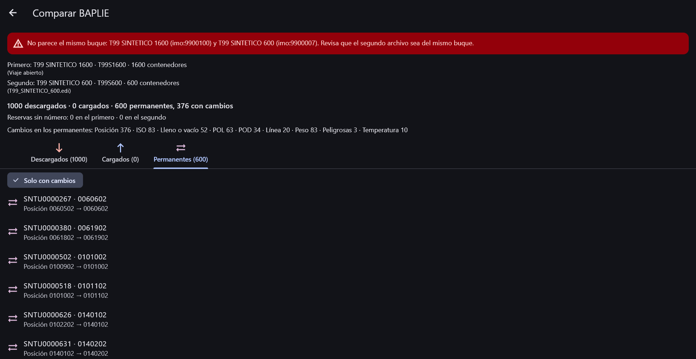

**«Generar BAPLIE de salida»** (Lista, con la escala confirmada):

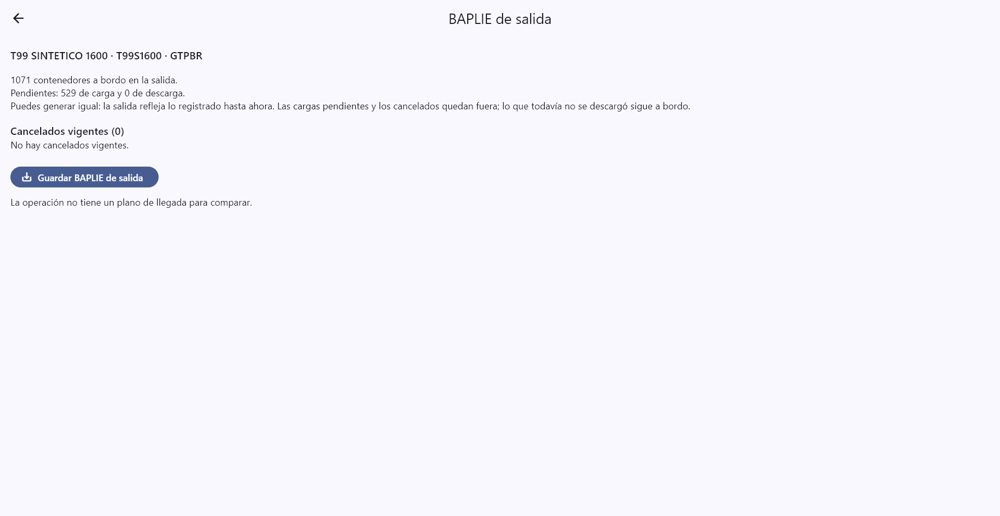

1. La pantalla dice cuántos contenedores quedan a bordo en la salida y los
   pendientes: «Pendientes: 529 de carga y 0 de descarga. Puedes generar igual: la
   salida refleja lo registrado hasta ahora. Las cargas pendientes y los cancelados
   quedan fuera; lo que todavía no se descargó sigue a bordo.»
2. «Cancelados vigentes (N)» y «Copiar cancelados».
3. «Guardar BAPLIE de salida» abre el diálogo de guardar y escribe el archivo con las
   reglas de 2.x. Con un plano de llegada en versión 1.5 no se genera: «… es versión
   1.5 (SMDG15) y se leyó con las reglas de 2.x … Importa el plano en SMDG20, SMDG21 o
   SMDG22.»
4. «Comparar con la llegada» compara la salida generada con el plano de llegada de la
   operación. Sin plano de llegada dice «La operación no tiene un plano de llegada para
   comparar.»

**«Listado de la agencia»** (Lista, con un plan de carga confirmado):

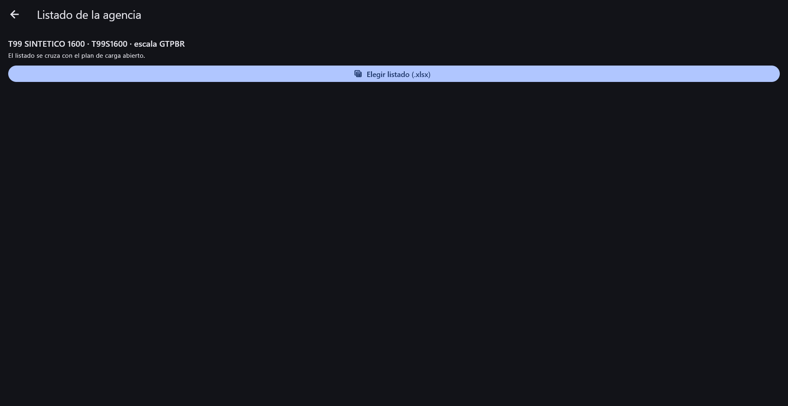

1. Pulsa «Elegir listado (.xlsx)» y elige el Excel de la agencia.
2. La app lo lee y resume: «7 filas en 2 agencias · 4 llenos · 3 vacíos», las filas
   que no entendió («Fila 14: OR 7: no marca lleno (F) ni vacío (E). Corrige esa fila en
   el Excel y vuelve a importarlo.»), y «Equivalencias con el plan»: para cada tipo,
   línea o puerto del listado que no coincide con el plan, propone el código del plan
   o pide elegirlo («Elige su código en el plan», «Otro código…»).
3. Abajo, «Cruce con el plan de <escala>»: cuántos llenos cruzan, cuántos del plan no
   están en el listado y los grupos de reservas.
4. «Confirmar e importar» queda apagado hasta resolver las equivalencias («Falta
   elegir 10 equivalencias antes de importar. Elige una para cada código pendiente.»).
   «Descartar» cierra sin guardar. Importado, el listado se guarda en la operación y
   el plano puede mostrar el «Número de orden» y operar por OR.

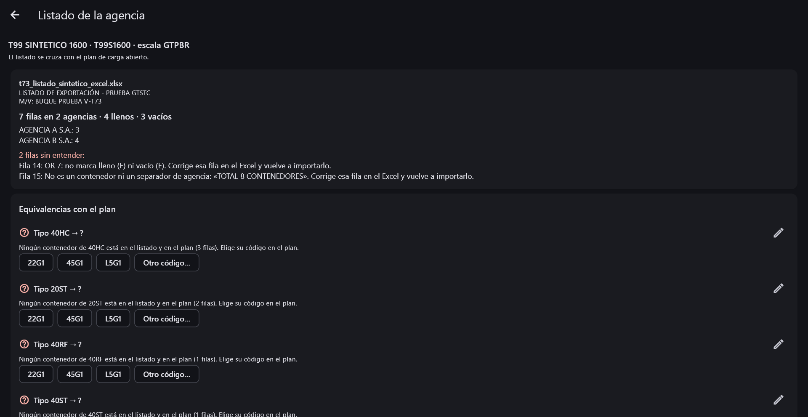

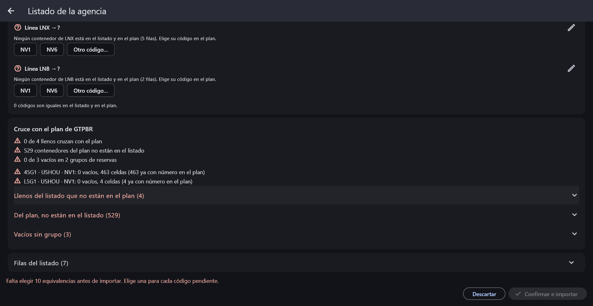

## 9. Nube y cuenta

Este capítulo va solo en texto: la pantalla de cuenta no se captura.

### 9.1 Dónde está

El icono de la nube de la barra superior y el chip del plano («Solo este dispositivo»,
«Al día»…) abren «Nube y cuenta». El chip resume el estado de envío:

| Chip | Qué significa |
|---|---|
| Solo este dispositivo | Sin cuenta: lo que registres se queda aquí |
| Conectando… | Buscando la nube |
| Al día | Todo lo registrado está en la nube |
| Enviando N | Hay N movimientos por subir |
| Sin conexión · N por enviar | Sin red; la cola espera |
| Sesión vencida: inicia sesión para enviar N | Hay que iniciar sesión de nuevo |
| Tu cuenta no está autorizada · N esperan · pide al responsable que la autorice | La cuenta existe pero no está activa |
| N rechazados por la nube, fuera del plan: regístralos de nuevo si hacen falta | La nube no aceptó esos movimientos |

### 9.2 Iniciar sesión

1. Abre «Nube y cuenta». En «Cuenta» dice: «Sin cuenta, lo que registres se queda en
   este dispositivo. Las cuentas las crea el responsable: la app no tiene registro.»
2. Escribe «Correo» y «Contraseña» y pulsa «Iniciar sesión». «Olvidé mi contraseña»
   envía un enlace al correo («Si el correo tiene cuenta, llegará un enlace para
   cambiar la contraseña.»). «Política de privacidad» abre el capítulo 13.
3. Con sesión, la pantalla muestra el nombre y el rol («Oficina» o «Muelle»), y uno de
   estos estados: «Cuenta autorizada», «Cuenta sin autorizar: lo que registres espera a
   que el responsable la active.» o «Sin conexión: datos guardados de la cuenta.»
4. «Cerrar sesión»: «Sesión cerrada. Lo pendiente de esta cuenta espera a que vuelva
   a iniciar sesión.»

Si la compilación no trae la nube: «Esta compilación no tiene la nube configurada: la
app trabaja en un solo dispositivo. Para sincronizar, pide al responsable una
compilación con la nube.»

### 9.3 Los roles

- **Oficina**: publica y cierra la operación, mueve y cancela embarques desde el plan,
  decide las solicitudes de cambio, genera el BAPLIE de salida.
- **Muelle**: registra descargas, cargas, re‑estibas y tapas, y pide cambios.

Todas las cuentas autorizadas ven las operaciones; el rol decide lo que cada una puede
registrar o aprobar.

### 9.4 Publicar una operación

1. Con un plano abierto y su escala confirmada, «Nube y cuenta» muestra «Operación de la
   escala abierta» con buque, viaje y puerto, y su estado: «Solo en este dispositivo»,
   «Publicada» o «Publicada y cerrada».
2. La oficina pulsa «Publicar operación». Desde entonces los movimientos de todos los
   dispositivos con cuenta se sincronizan sobre esa operación.
3. En «Operaciones abiertas en la nube» se listan las publicadas, para unirse desde
   otro dispositivo.
4. Al terminar la escala, la oficina pulsa «Cerrar operación»; una operación cerrada
   ya no admite movimientos.

### 9.5 Trabajar sin conexión

Sin red, la app sigue registrando y el chip pasa a «Sin conexión · N por enviar». Al
volver la red, envía la cola sola y el chip vuelve a «Al día». Los viajes recientes se
abren sin conexión. En Windows, antes de desinstalar hay que llegar a «Al día».

## 10. Exportar: CSV, PDF y JSON

1. Con un viaje abierto, toca «Exportar viaje» (la flecha hacia abajo de la barra
   superior).
2. Elige «PDF», «CSV» o «JSON».

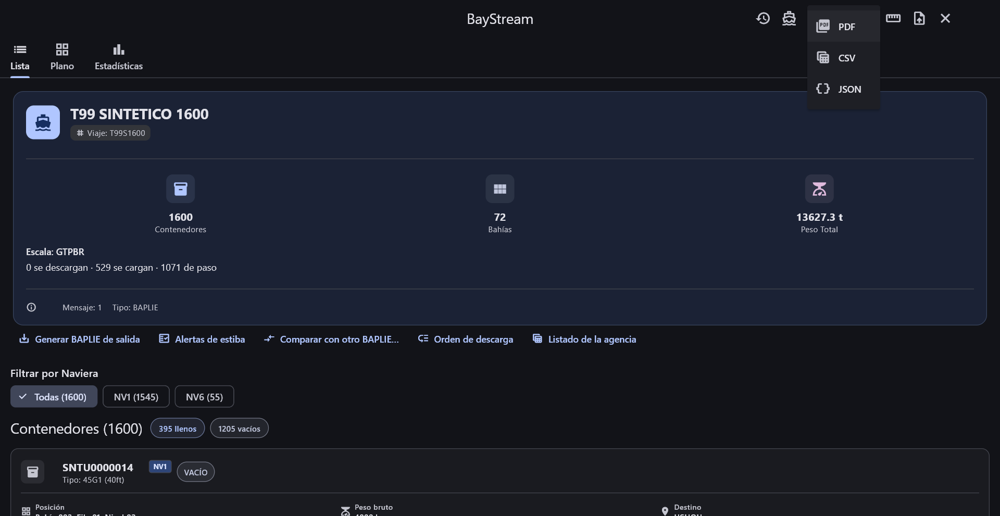

3. En Windows se abre «Guardar reporte del viaje» con el nombre propuesto
   `BayStream_<buque>_<viaje>.pdf`. Elige la carpeta y pulsa «Guardar». Con el PDF, la
   app avisa «Generando reporte PDF...» mientras lo arma.
4. Al terminar: «Exportación PDF completada» (o CSV, o JSON).

Qué trae cada formato:

- **PDF**: el reporte del viaje con las bahías dibujadas, cubierta y bodega, y la
  leyenda (Vacío y OOG se distinguen en celda y leyenda).
- **CSV**: una fila por contenedor, con encabezados en español: `id`, Contenedor,
  Tipo ISO, Estado, Posición, Peso bruto (kg), Peso VGM (kg), Tara (kg), Puerto de
  carga, Puerto de descarga, Destino final, Operador, Peligroso, Clase IMDG, Número
  ONU, Refrigerado, Temperatura, Unidad de temperatura, Sobredimensionado y las
  cuatro medidas de sobredimensión en cm. Los valores: «lleno», «vacío»,
  «desconocido», «sí», «no».
- **JSON**: el viaje completo tal como lo guarda la app.

En Android, la exportación la entrega el sistema (guardar o compartir) **(no
recorrido en esta edición)**.

## 11. Modo claro y oscuro

1. Toca «Parámetros» (la regla de la barra superior).
2. En «Tema de la aplicación», abre «Tema» y elige «Seguir al sistema», «Claro» u
   «Oscuro». «La elección se guarda en este dispositivo. Seguir al sistema adapta el
   tema a sus cambios.»

En la misma pantalla están «Política de privacidad» (capítulo 13) y «Parámetros del
buque» (el editor del perfil, capítulo 4).

## 12. Mensajes de error y qué hacer

Todos los mensajes de la app dicen la causa y la acción. Esta tabla agrupa los más
frecuentes; el texto exacto puede llevar el nombre del archivo, el segmento o la
operación.

### 12.1 Al leer un BAPLIE

| Mensaje | Qué hacer |
|---|---|
| Este archivo no parece un BAPLIE: no se reconoce su cabecera UNH/S009. Selecciona una exportación BAPLIE completa. | Elegiste otro tipo de archivo. Pide la exportación BAPLIE |
| Versión BAPLIE no admitida: la cabecera UNH declara … BayStream lee la familia 2.x (SMDG20, SMDG21 y SMDG22). Pide una exportación compatible. | Pide el BAPLIE en 2.x |
| El contenido del archivo BAPLIE está vacío / No se encontraron segmentos válidos en el archivo | El archivo está vacío o truncado. Vuelve a exportarlo |
| No se encontró el nombre del buque en el segmento TDT | Pide una exportación con el TDT completo |
| No se pudo interpretar el segmento LOC (n.º 245 del archivo) del BAPLIE: trae un dato que el lector no esperaba. Revisa ese segmento en el archivo o pide una nueva exportación. | Abre el archivo en ese segmento y corrígelo, o pide otra exportación |
| Versión 1.5 (la cabecera UNH declara SMDG15), leída con las reglas de 2.x; revisa pesos y peligrosas | No es un error: revisa pesos y peligrosas, y no esperes BAPLIE de salida |
| Pesos revisados en MEA / Posiciones mal formadas en LOC+147 / Dígito de control inválido en EQD / Archivo posiblemente incompleto | Los avisos de 3.3, con su acción en la tarjeta |
| Carga cancelada: no se confirmó la geometría del buque | Vuelve a cargar y confirma «Parámetros del buque» |

### 12.2 En el perfil del buque

| Mensaje | Qué hacer |
|---|---|
| Falta resolver el límite de apilamiento: escríbelo o marca que no lo tienes. | Escribe «Límite por pila» o marca «No lo tengo» |
| Valor no numérico: escribe un número. | Solo cifras |
| No puede ser menor que N: escribe N o más. / El archivo trae carga en …; con … quedaría fuera del plano. Escribe al menos N. | El archivo ya trae carga ahí: sube el valor |
| Este viaje trae carga en el nivel NN: no se puede quitar | Ese nivel está ocupado en el archivo |
| Revisa frontera y anclas: bodega debajo de la frontera y cubierta desde ella. | La frontera (80) y las anclas (2 y 82) no son coherentes |
| Posición de toma no válida: escribe siete dígitos y una bahía distinta de 000. | La toma va como BBBRRTT |
| La frontera y las anclas no forman una geometría válida: revísalas antes de cargar tomas. | Corrige «Frontera y anclas» y vuelve a los rangos |
| No hay códigos pegados: pega al menos uno. | El cuadro de pegar estaba vacío |
| Tapa N: las filas no tienen el formato esperado; escribe filas de uno o dos dígitos separadas por coma. / Tapa N: hay una fila repetida; quítala. | Corrige las filas de esa tapa |

### 12.3 En la operación

| Mensaje | Qué hacer |
|---|---|
| Esta escala todavía no tiene operación guardada: vuelve a abrir el BAPLIE de llegada y confirma la escala para registrar. | Abre el plano de llegada y confirma el puerto |
| Confirma la escala para ver el plan de carga. | Elige el puerto en «Parámetros del buque» |
| Esta operación todavía no tiene listado de agencia. / Importa el listado de agencia para operar por OR. | Importa el listado (8.5) |
| Este contenedor no tiene OR en el listado de la agencia: importa el listado actualizado. | Pide el listado al día |
| Hora no válida: escríbela como HH:mm (00:00 a 23:59). | Corrige la hora |
| No se registró: … / No se deshizo: … | Lee la causa; la bitácora no cambió |
| Un conflicto («… Si el registro fue un error, deshazlo desde el detalle de la celda» / «… del contenedor» / «… con «Deshacer conflicto»») | Dos registros chocan; la acción al final del mensaje dice desde dónde se deshace |
| La operación todavía no se cargó o cambió mientras tanto: espera un momento e inténtalo de nuevo. | Espera y repite |
| Mover exige una cuenta autorizada: inicia sesión… / Se necesita una cuenta autorizada y una operación publicada. | Inicia sesión; la oficina publica |
| Operación cerrada. | Ya no admite movimientos |

### 12.4 Con el listado de la agencia

| Mensaje | Qué hacer |
|---|---|
| No hay un plan de carga confirmado: abre primero el plan de carga (BAPLIE) y confirma la escala. | Carga el plan y confirma el puerto |
| Fila N: … Corrige esa fila en el Excel y vuelve a importarlo. | La fila no se entendió; corrígela en el Excel |
| Falta elegir N equivalencias antes de importar. Elige una para cada código pendiente. | Resuelve cada «→ ?» |
| Ningún contenedor de X está en el listado y en el plan (N filas). Elige su código en el plan. | Elige el código equivalente |

### 12.5 Nube, sesión y sincronización

Los estados del chip están en 9.1. Además: «Falta el correo: escríbelo para recuperar
la contraseña.», «Cuenta sin autorizar: lo que registres espera a que el responsable
la active.», y «Sesión sin confirmar desde las HH:MM · inicia sesión de nuevo».

### 12.6 Exportar

«No se pudo exportar PDF por un error interno de la aplicación; el detalle técnico
quedó en el registro. Inténtalo de nuevo y, si se repite, reinicia la aplicación.»
(igual para CSV y JSON). Si el diálogo de guardar se cancela, no hay mensaje.

### 12.7 El dictado

Los cinco mensajes de 6.3: permiso denegado, sin conexión o servicio no disponible,
no se entendió, español no disponible, voz no disponible. En todos, escribe la
búsqueda.

### 12.8 Los dos genéricos

- «No se pudo <operación> por un error interno de la aplicación; el detalle técnico
  quedó en el registro. Inténtalo de nuevo y, si se repite, reinicia la aplicación.»
- «No se pudo <operación>: falló la lectura o la escritura de los datos guardados en
  este dispositivo…»: el almacén local tuvo un problema; reinicia y, si sigue, avisa al
  responsable.

## 13. Privacidad

La política completa está dentro de la app: «Parámetros» → «Política de privacidad»,
y también en «Nube y cuenta». Lo esencial:

- **Sin cuenta, todo se queda en tu dispositivo.** Los archivos que abres y lo que
  haces con ellos se procesan y se guardan solo ahí; la app no los envía a ningún
  servidor.
- **Los archivos que abres** (BAPLIE y listados en Excel) contienen información
  comercial del buque, del viaje y de la carga. No están pensados para contener datos
  personales.
- **Con cuenta, la operación se sincroniza.** Las cuentas las crea el administrador; la
  app no permite crearlas. Tu correo y tu contraseña los gestiona Firebase
  Authentication, de Google; BayStream no guarda tu contraseña. Al publicar o unirte a
  una operación se guardan en Cloud Firestore los archivos de la operación, el perfil
  del buque y cada movimiento, con el identificador de tu cuenta, tu nombre, tu rol y
  la hora. Solo las cuentas autorizadas y el administrador lo ven.
- **Dónde se guarda**: los datos de la operación, en la región de Firebase en México.
- La pantalla indica la fecha de la última actualización de la política y el contacto
  del responsable.

## 14. Glosario

- **BAPLIE**: el mensaje EDIFACT con el plano de estiba de un buque (Bayplan/stowage
  plan occupied and empty locations). BayStream lee la familia 2.x.
- **Bahía / Fila / Nivel**: las tres coordenadas de una posición. La bahía corre de proa
  a popa (pares para 40 pies, impares para 20); la fila, de banda a banda (00 en el
  centro, pares a un lado e impares al otro); el nivel, de abajo arriba (bodega desde
  02, cubierta desde 82).
- **BBBRRTT**: la posición escrita con siete dígitos: bahía, fila, nivel. En la app se
  muestra como «Bahía 002, Fila 01, Nivel 82» y se escribe como `0020182` o
  `002-01-82`.
- **Cubierta y bodega**: las dos zonas de la bahía; la frontera está en el nivel 80.
- **Tapa de escotilla**: la cubierta de la bodega. El BAPLIE no la declara; se declara
  en el perfil (anexo).
- **Sombra de 40 pies**: las celdas de las bahías impares vecinas que un 40 o 45
  ocupa; en el plano, «Ocupado por 40 pies».
- **Celda reservada**: una posición que el plan de carga reserva para un contenedor
  sin número todavía.
- **Escala**: el puerto de esta operación. Define qué se descarga, qué se carga y qué va
  de paso.
- **De paso**: la carga que ni baja ni sube en esta escala.
- **OR**: el número de orden del listado de la agencia, con el que el muelle identifica
  cada carga.
- **Listado de la agencia**: el Excel de la agencia con los contenedores que se cargan,
  su OR, tipo, puerto, línea y pesos.
- **VGM**: el peso bruto verificado del contenedor. Cuando el archivo solo trae VGM, la
  app lo usa como peso.
- **IMDG / IMO / ONU**: el código marítimo de mercancías peligrosas; la clase IMO y el
  número ONU de la mercancía.
- **OOG**: carga sobredimensionada (out of gauge).
- **Refrigerado y toma**: un contenedor con temperatura controlada y el enchufe del
  buque que lo alimenta.
- **Re‑estiba**: un contenedor que sale del buque para volver a estibarlo en la misma
  escala; no cuenta entre los que bajan.
- **Perfil del buque**: la geometría (filas, niveles, frontera), el límite de
  apilamiento, las tomas y las tapas que la app guarda por buque.
- **Solicitud de cambio**: un movimiento que el muelle pide y la oficina aprueba o
  rechaza.
- **Bitácora**: el registro de movimientos de la operación; solo anexa.

---

## Anexo · La geometría a mano

El BAPLIE no trae filas, niveles, tapas ni tomas de refrigerados: solo las posiciones
ocupadas. Este anexo explica cómo declarar lo que el archivo no trae, desde el editor
«Parámetros del buque» (capítulo 4). Todo lo que se escribe aquí se guarda **solo al
confirmar** («Confirmar y ver el plano» o «Guardar perfil»); «Cancelar» lo descarta.

**Lo que todavía no existe:** declarar «todas las bahías del buque». Hoy el selector de
bahías muestra las que trae el archivo (con carga propia, con reservas o con sombra de
40), no un inventario del buque. Ese inventario está anotado para el Sprint 4 (decisión
10.87).

### A.1 El ejemplo

El ejemplo es el archivo de prueba `PRUEBA_T98.edi`: dos contenedores de 20 pies en
las posiciones 0010182 y 0030182 (bahías 001 y 003, fila 01, nivel 82). La app propone
«Filas a babor 0», «Filas a estribor 1», ningún nivel de bodega y el nivel 82 de
cubierta: «2 columnas × 1 niveles = 2 huecos por bahía». Un buque real tiene más; lo
que sigue es cómo declararlo.

### A.2 Las filas

1. Abre el editor (al cargar, o «Perfiles guardados» → lápiz).
2. En «Filas a babor» y «Filas a estribor» escribe cuántas filas tiene el buque a cada
   banda. La app no deja bajar del mínimo observado: «No puede ser menor que 1:
   escribe 1 o más.»
3. En «Fila 00 en cubierta» y «Fila 00 en bodega» declara si la fila central existe en
   cada zona: «No declarada», «Sí existe» o «No existe». Sin declaración, la app dibuja
   la 00 en el centro y trata la 01 y la 02 como vecinas.

### A.3 La frontera y las anclas

Despliega «Frontera y anclas». Los tres valores vienen de la numeración ISO: la
frontera cubierta / bodega en 80, el primer nivel de bodega en 2 y el primero de
cubierta en 82. Solo se cambian si el buque numera distinto. Si la combinación no es
coherente, la app lo dice: «Revisa frontera y anclas: bodega debajo de la frontera y
cubierta desde ella.»

### A.4 Los niveles

1. En «Niveles de cubierta» pulsa «Agregar»: ofrece el siguiente («Nivel 82», luego
   84…). Repite hasta el último nivel del buque.
2. En «Niveles de bodega», igual («Nivel 08» sigue al 06).
3. Para quitar un nivel que el buque no tiene, toca la X de su ficha. Los que trae el
   archivo no tienen X.
4. «Rejilla resultante» muestra el efecto: «23 columnas × 5 niveles = 115 huecos por
   bahía», y «Perfil modificado; pendiente de guardar.»

### A.5 Las tomas de refrigerado

Despliega «Tomas de refrigerado (N)». Lo que propone el archivo es una **cota
inferior** (las posiciones donde hoy hay un refrigerado): «puede haber más tomas».
Hay tres formas de cargarlas.

**Por rangos** («Cargar por rangos»):

1. «Bahías»: números y rangos con paso, como `002-038/4, 041, 044`. «Las bahías se
   usan tal como se escriben, sin calcular pares: si sabes el extremo, escribe las
   impares; si no, las pares.»
2. «Filas»: vacío toma todas las de la geometría; o `01-10`, o una lista.
3. «Niveles»: de dos en dos por omisión: `82-88` o `02-08`.
4. Pulsa «Agregar por rango». La app muestra lo que va a hacer antes de hacerlo:
   «Se agregan 12 tomas: 0020182, 0020282, 0020382… Ya estaban 0. Se descartan 0 con
   la fila o el nivel fuera de la geometría. Cargar no declara: la casilla de
   declaración no cambia.» Confirma con «Agregar». «Quitar por rango» hace lo
   contrario.

En el ejemplo, `002-010/4` en bahías, `01-04` en filas y `82` en niveles cargaron las
12 tomas de las bahías 002, 006 y 010, filas 01 a 04, nivel 82.

**Pegando una lista** («Pegar una lista de códigos»): pega códigos BBBRRTT separados
por comas, espacios o saltos de línea y pulsa «Agregar la lista».

**Una por una**: escribe la «Posición BBBRRTT» (ejemplo `0020182`) y pulsa «Agregar
toma». Cada toma queda como una ficha con su X para quitarla.

Al final del bloque está la casilla **«Declaro este conjunto de tomas para el
buque»**: «Marca solo después de revisar las tomas. Confirmar la geometría no las
declara.» Sin esa marca, las tomas siguen siendo propuestas (o heredadas de
plantilla) y las Alertas de estiba no las usan para avisar de un refrigerado sin
enchufe.

### A.6 Las tapas de escotilla

1. Pulsa «Editar tapas por bahía». «Solo bahías con bodega observada en los planes,
   incluidas las huellas de 40 pies. El BAPLIE no declara tapas: revisa la hoja del
   buque antes de declarar.»
2. Elige la «Bahía de bodega».
3. En «Declaración» elige «Sin declarar», «Sin tapa · bodega abierta», «Una tapa
   automática» o «Tapas de grúa».
4. Con «Tapas de grúa», elige «1 tapa», «2 tapas» o «3 tapas» y escribe las filas de
   cada una («Tapa 1 · filas», por ejemplo `22, 20, 18, 16, 14, 12, 10, 08, 06, 04, 02`).
   La pantalla recuerda las «Filas de la geometría».
5. Pulsa «Revisar declaración»: dibuja las tapas con sus filas.
6. «Copiar a otras bahías» aplica la misma declaración a las bahías que marques
   («Reemplaza la declaración de las bahías seleccionadas.»).
7. «Usar estas declaraciones» vuelve al editor; se guardan al confirmar el perfil.

Con las tapas declaradas, el título de la bahía en el plano deja de decir «tapas sin
declarar», «Tapas en la operación» permite registrar «Quitar» y «Reponer», y el orden de
descarga cuenta los movimientos de tapa.

### A.7 Guardar

Revisa «Rejilla resultante» y pulsa «Confirmar y ver el plano» (al cargar) o «Guardar
perfil» (al editar). «Cancelar» o «Cancelar la carga» descarta todo lo escrito.

---

## Lista de lo PROVISIONAL, hallazgos y limitaciones

### PROVISIONAL (lo que todavía no está publicado)

| Qué | Estado al 21-oct-2026 |
|---|---|
| El instalador MSIX de Windows (capítulo 2.1) | Existe (T-93) y no está publicado; el procedimiento de instalación no se recorrió en esta edición |
| La app de Android en Google Play (2.2) | La versión anterior está en la prueba interna; la de `sprint3-cierre-2` no está publicada |
| La Web nueva (2.3) | `baystream-app.web.app` sirve la versión anterior; la de este manual se publica después de la mezcla |
| «Tapas PROVISIONAL» en la operación (8.1, 8.2) | Es como lo nombra la propia app: el estado de las tapas se deriva de la bitácora |

### Hallazgos (se anotan, no se corrigen: decisión 10.73)

1. **«Confirmar y ver el plano» abre la Lista**, no el plano. Conocido (10.97, va al
   Sprint 4). Se repitió en Windows y en el teléfono.
2. **A 360 dp con la letra del sistema en 1.45, en la pantalla de inicio el botón
   flotante «Cargar BAPLIE» tapa parte de «Seleccionar archivo»** (`manual/h00-inicio-letra-grande.png`).
   Se puede cargar igual con el botón flotante.
3. **A 360 dp la barra superior deja fuera del borde «Parámetros», «Cargar archivo
   BAPLIE» y «Limpiar datos»**, sin ninguna señal de que hay más botones. Se llega
   deslizando la barra (T-91). En Windows, en la pestaña «Plano» la barra se pliega y
   la lupa y «Exportar viaje» solo se ven tras «Desplegar acciones» (T-97). Es diseño,
   pero conviene decirlo en el manual, y se dice en 2.2.
4. **Con la letra en 1.45**, la línea de resumen del plano se corta («Pendientes de
   carga: 0 en e…») y la leyenda deja «Refrigera…» en el borde. Conocido (10.94).

### Limitaciones de esta edición

- Los archivos de prueba (`tool/t99_sintetico.dart` con 1600 y 600 contenedores, y
  `PRUEBA_T98.edi`) no traen descargas ni avisos de lectura: los procedimientos de
  **descarga, re‑estiba, pendientes de descarga, «Tipo de BAPLIE», carga por OR,
  arrastrar, solicitudes de cambio, dictado, avisos de lectura, buques homónimos,
  «La carga excede el perfil guardado» y exportar en Android** se describen desde los
  textos de la app y están marcados «(no recorrido en esta edición)».
- La operación con cuenta (publicar, unirse, roles, sin conexión) va solo en texto:
  esta edición se escribió sin sesión y sin capturar «Nube y cuenta».
- El listado de la agencia se recorrió con el listado sintético de las pruebas
  (`test/fixtures/t73_listado_sintetico_excel.xlsx`), que no coincide con el plan de
  prueba; por eso las equivalencias quedan sin resolver y no se importó.
- La Web se abrió y se comprobó en la máquina local; no hay capturas de la Web.
- El instalador de Windows y Google Play no se recorrieron.
